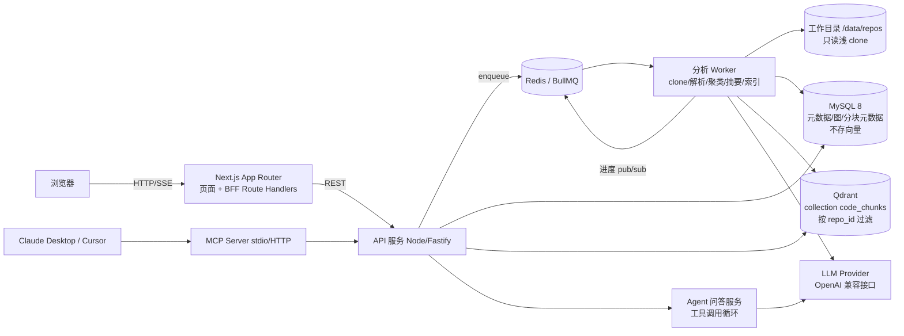
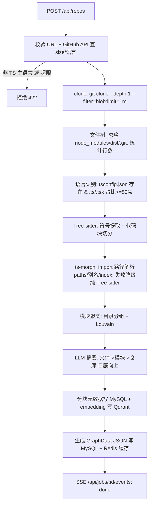
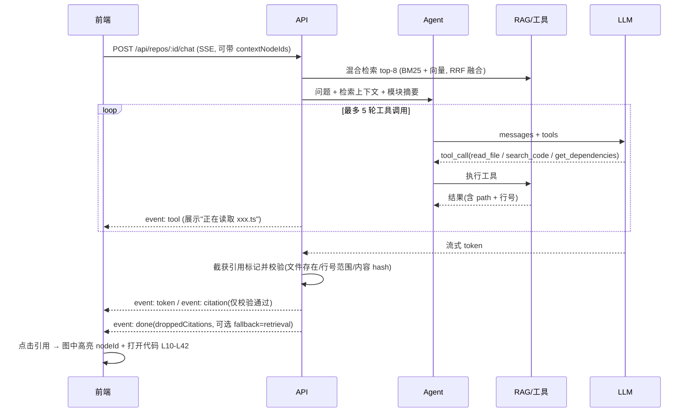

# 可视化代码仓库分析(RepoLens)架构设计

> 输入 GitHub 仓库地址 → 生成交互式架构图(模块/目录/依赖)→ 对仓库自然语言问答(带文件/行号引用)。
> 目标:演示效果好、可开源、1 人 4 周完成。**硬约束:第 1 周仅支持 TypeScript 仓库**。

## 1. 目标与范围

### 1.1 MVP(必须)
- 公开 GitHub 仓库 URL 输入,只读浅 clone(`--depth 1`),仓库 ≤ 300MB(磁盘占用,含 .git)、源文件 ≤ 5000。
- TypeScript/TSX 解析:文件树、import/export 依赖、tsconfig `paths` 别名解析。
- 模块聚类(目录 + 依赖社区),LLM 生成模块摘要。
- 交互式架构图:模块视图 ↔ 文件视图下钻,搜索、高亮、折叠。
- 自然语言问答:混合检索 + Agent 工具调用,SSE 流式输出,引用 `path:L10-L42`,点击引用高亮图节点。
- 分析进度实时推送(SSE)。

### 1.2 加分项(第 3-4 周或之后)
- MCP server:让 Claude Desktop / Cursor 直接调用仓库分析能力。
- 多语言:JavaScript、Python、Go(通过 `LanguageAnalyzer` 插件接入 Tree-sitter)。
- 循环依赖检测、"影响面分析"(改一个文件会影响谁)、分析结果分享链接。
- 私有仓库(GitHub OAuth)、增量重分析(按 commit SHA)。

### 1.3 3 分钟 Demo 流程
| 时间 | 动作 | 展示点 |
|---|---|---|
| 0:00-0:20 | 粘贴 `https://github.com/honojs/hono` 点击分析(命中预解析缓存) | 输入简单 |
| 0:20-0:50 | 进度条:clone → 解析 → 聚类 → 摘要(SSE 实时) | 异步队列、流式进度 |
| 0:50-1:40 | 模块图自动布局,点模块看 LLM 摘要,双击下钻到文件依赖 | 可视化 + 聚类 |
| 1:40-2:40 | 问"中间件是怎么串联执行的?",流式回答,点击引用 → 图节点高亮 + 代码片段 | RAG + Agent + 引用联动 |
| 2:40-3:00 | 在 Cursor 中通过 MCP 调用 `ask_repo` 同一问题 | MCP |

预解析示例仓库(全部 TS,**Demo 前预先分析并缓存结果**,现场不临时解析):
| 规模 | 仓库 | 用途 |
|---|---|---|
| 小 | `pmndrs/zustand` | 秒级出图,冒烟测试与快速兜底 |
| 中(主演示) | `honojs/hono` | 3 分钟 Demo 主线;**兜底视频用 hono 录制** |
| 较大 | `colinhacks/zod` | 展示大图性能:默认折叠到目录/模块层级,按需下钻 |
| 备选 | `trpc/trpc` | monorepo 结构展示,时间允许时演示 |

降级顺序:线上实时 → 打开预解析缓存 → 播放 hono 兜底视频。

## 2. 总体架构



### 2.1 模块划分
| 模块 | 包 | 职责 |
|---|---|---|
| 前端 | `apps/web` | 输入页、进度页、图视图(React Flow)、问答面板、代码预览 |
| API | `apps/api` | REST + SSE;任务创建、查询图、问答流;限流、鉴权(可选) |
| Worker | `apps/worker` | BullMQ 消费者,执行分析流水线各阶段 |
| 解析核心 | `packages/analyzer` | `LanguageAnalyzer` 接口 + `TypeScriptAnalyzer` 实现;依赖图、聚类 |
| 索引/RAG | `packages/rag` | 代码分块(按符号)、embedding 写 Qdrant、BM25(MySQL FULLTEXT)+ 向量混合检索 |
| Agent | `packages/agent` | 工具定义、ReAct/function-calling 循环、引用抽取 |
| MCP | `apps/mcp` | 基于 `@modelcontextprotocol/sdk` 暴露 tools,内部调 API |
| 存储 | `packages/db` | Drizzle ORM schema、迁移、Redis key 工具 |
| 共享类型 | `packages/shared` | zod schema:GraphData、API DTO、SSE 事件 |

## 3. 技术选型与理由
| 领域 | 选型 | 理由 / 权衡 |
|---|---|---|
| 前端 | Next.js 14+ App Router、Tailwind、shadcn/ui | 与岗位一致;RSC 渲染列表页,图与问答为 Client Component |
| API | Node.js + Fastify(独立服务) | SSE 长连接、长任务不适合 Vercel Serverless 时限;Fastify 性能好、schema 校验 |
| 队列 | BullMQ + Redis | 重试、并发控制、进度上报(`job.updateProgress`)、限流器内置 |
| 关系库 | MySQL 8 + Drizzle ORM | 岗位要求;仓库/任务/节点/边/分块元数据/对话持久化;**不存向量** |
| 向量存储 | **Qdrant**(`@qdrant/js-client-rest`) | 原生 payload 过滤(filter 字段 `repo_id`,另有 `path`)、单 Docker 镜像部署、HNSW 检索快,多仓库共用一个 collection;避免 MySQL 存 BLOB + 内存暴力检索带来的 API 进程内存压力。代价是多一个服务。仍保留 `VectorStore` 接口抽象。不选 pgvector(要再维护一套关系库)、Pinecone(外部依赖、开源不友好) |
| 代码解析 | **Tree-sitter(tree-sitter-typescript)** | 负责代码块切分与符号提取(函数/类/接口/类型 + 行号);快、容错,后续多语言统一底座 |
| import 路径解析 | **ts-morph** | 只负责解析 TS import 路径(含 tsconfig `paths`/`baseUrl`、re-export、index 文件);**失败时降级为纯 Tree-sitter**(抽 import 字面量 + 相对路径/简单别名规则解析) |
| | madge(校验) | 仅离线交叉验证依赖与循环检测,不进主路径 |
| 聚类 | 目录前缀分组 + Louvain(graphology-communities-louvain) | 目录结构为主保证可解释,社区算法修正跨目录耦合 |
| LLM | OpenAI 兼容接口(OpenAI / DeepSeek / 通义),Vercel AI SDK | 统一 function calling 与流式;模型可配,摘要用便宜模型,问答用强模型 |
| Embedding | 本地 ONNX `Xenova/multilingual-e5-small`(384 维,fp32;D4 定稿,T-214) | 无外部费用、代码不出机;只在 worker 内跑,峰值内存约 2.5 GB |
| 图可视化 | **React Flow + elkjs** | React 原生、自定义节点(显示摘要/徽标)方便;elk 分层布局适合依赖图。Cytoscape 适合 >2000 节点,作为文件级大图降级 |
| 流式 | SSE(`text/event-stream`) | 单向推送足够,穿透代理简单,比 WebSocket 轻 |
| 校验 | zod | 前后端共享 DTO,LLM 结构化输出校验 |

## 4. 数据流

### 4.1 分析流水线

各阶段说明:
1. **clone**:临时目录 `/data/repos/{repoId}-{commitSha}`,禁用 hooks(`-c core.hooksPath=/dev/null`),超时 60s。
2. **文件树**:`fast-glob` 遍历,记录 `path/size/loc/ext`;跳过 >500KB 文件与二进制。
3. **TS 识别**:`analyzerRegistry.detect(repo)` 返回首个 `supports()` 为真的 analyzer;第 1 周只注册 `TypeScriptAnalyzer`。
4. **依赖抽取**:`ImportDeclaration`、`ExportDeclaration`、动态 `import()`、`require()`;区分 internal / external(npm 包)/ type-only。
5. **聚类**:默认取 `src/` 下两级目录为模块;monorepo 以 `packages/*` 为模块;Louvain 用于 >40 个目录时合并。
6. **LLM 摘要**:文件摘要只喂导出符号签名+前 80 行(控 token);模块摘要汇总文件摘要;结果按 `contentHash` 缓存。
7. **图数据**:模块级边 = 文件边聚合,`weight` = import 次数。

解析扩展口:
```ts
export interface LanguageAnalyzer {
  id: 'typescript' | 'javascript' | 'python' | 'go';
  supports(repo: RepoSnapshot): Promise<boolean>;
  parseFile(file: SourceFile): Promise<ParsedFile>; // imports, exports, symbols(行号)
  resolveImport(spec: string, from: string): string | null; // 内部路径或 null(外部)
}
```

### 4.2 问答流程

- 引用格式约定:模型输出 `[[src/hono.ts#L10-L42]]`,后端在流中截获并校验文件存在、行号在范围内、内容 hash 一致(防幻觉)。**只有校验通过的引用才下发 `citation` 事件,不带 `verified` 字段**;校验失败的直接丢弃,丢弃数量放在 `done.droppedCitations`。前端无需处理"未验证"状态。
- Agent 工具:`search_code(query)`、`read_file(path, start, end)`(单次 ≤200 行)、`get_dependencies(path, direction)`、`get_module_summary(moduleId)`、`list_files(dir)`。

## 5. 接口约定

### 5.1 REST / SSE
| 方法 | 路径 | 说明 |
|---|---|---|
| POST | `/api/repos` | 创建分析任务,返回 `{id, jobId}` |
| GET | `/api/repos/:id` | 仓库/最近任务状态 |
| GET | `/api/jobs/:id/events` | SSE 进度 |
| GET | `/api/repos/:id/graph?parentId=&includeExternal=` | 图数据:不传 `parentId` 返回顶层,传则返回该父节点直接子节点 + 相关边;`includeExternal=true` 额外返回派生的 `x:` 外部包节点(默认否) |
| GET | `/api/repos/:id/files?path=&start=&end=` | 读文件片段 |
| GET | `/api/repos/:id/nodes/:nodeId` | 节点详情(摘要、导出符号) |
| POST | `/api/repos/:id/chat` | 问答(SSE 响应) |
| GET | `/api/repos?repo=owner/name` | 查询已有分析(命中缓存) |

说明:`:id` 即 `repoId`(`repo.id`);`jobId` 为 BullMQ 任务 id(`analysis_task.job_id`)。

```jsonc
// POST /api/repos  请求
{ "repoUrl": "https://github.com/honojs/hono", "ref": "main" }
// 202 响应(同 repo+commit 已分析则 200 直接返回)
{ "repoId": 12, "jobId": "12:a1b2c3d", "status": "queued", "repo": "honojs/hono", "commitSha": "a1b2c3d" }
// 422
{ "error": { "code": "UNSUPPORTED_LANGUAGE", "message": "第 1 周仅支持 TypeScript 仓库" } }
```

错误码(shared `API_ERROR_CODES`,错误体 `{error:{code,message}}`):

| code | HTTP | 场景 |
|---|---|---|
| `BAD_REQUEST` | 400(框架 4xx 保留原状态码,如 413/415) | 参数或请求体格式非法 |
| `INVALID_REPO_URL` | 400 | `repoUrl` 存在但不是合法的 GitHub 仓库地址 |
| `REPO_NOT_FOUND` | 404 | 仓库不存在、不可访问或 ref 无效;资源 id 不存在。私有仓库在 GitHub 返回 404 时也是这个码,不透露是否存在。`ref` 为 40 位 SHA 时不跑 ls-remote,只有 `repoInfo` 明确 404 才返回此码(不建任务、不计 `rl:ip`);403 限流、5xx、网络错误照常放行 |
| `REPO_NOT_READY` | 409 | 图还没生成 |
| `REPO_TOO_LARGE` | 413 | 仓库超过 `MAX_REPO_MB` |
| `UNSUPPORTED_LANGUAGE` | 422 | 非 TypeScript 仓库 |
| `REPO_NOT_PUBLIC` | 422 | GitHub `repoInfo` 返回 `private: true`,文案「只支持公开仓库」;在建仓库/任务之前拒绝 |
| `RATE_LIMITED` | 429 | 限流 |
| `INTERNAL` | 500 | 内部错误 |

```jsonc
// GET /api/repos/:id   (repo / commitSha 与 POST /api/repos 响应同名同义;commitSha 优先取最近一次已完成(done)任务的 commit,没有已完成任务时取最新任务的;jobId/status/stage/progress 始终是最新任务的)
{ "repoId": 12, "jobId": "12:a1b2c3d", "repo": "honojs/hono", "commitSha": "a1b2c3d…(40 位)", "status": "running", "stage": "parsing", "progress": 42,
  "stats": { "files": 312, "modules": 14, "edges": 980 }, "error": null }
```
```text
// GET /api/jobs/:id/events  (id 为 Redis Stream ID,支持 Last-Event-ID 续传)
event: progress
data: {"jobId":"12:a1b2c3d","stage":"cloning","progress":10,"message":"cloned 4.2MB"}

event: graph_ready
data: {"jobId":"12:a1b2c3d","repoId":12,"graphUrl":"/api/repos/12/graph"}

event: stage_error
data: {"jobId":"12:a1b2c3d","stage":"summarizing","message":"LLM 不可用,摘要降级为规则摘要"}

event: done
data: {"jobId":"12:a1b2c3d","status":"done","stats":{"files":412,"chunks":2900,"costUsd":0.31}}
```
```jsonc
// POST /api/repos/:id/chat  请求(contextNodeIds 可选:用户在图上选中的节点,优先检索)
{ "sessionId": 7, "message": "中间件是怎么串联执行的?", "contextNodeIds": ["m:src/middleware"] }
```
```text
// tool 事件可选:展示"正在读取 xxx",前端可忽略
event: tool
data: {"name":"read_file","args":{"path":"src/compose.ts","start":1,"end":80}}

event: token
data: {"text":"中间件由 compose 函数按洋葱模型串联"}

// 仅校验通过才下发,无 verified 字段
event: citation
data: {"id":1,"path":"src/compose.ts","startLine":10,"endLine":42,"nodeId":"f:src/compose.ts","moduleId":"m:src"}

event: done
data: {"messageId":881,"droppedCitations":1,"fallback":"retrieval","usage":{"in":5321,"out":402}}

// 出错时(替代 done,之后流结束)
event: error
data: {"code":"BUDGET_EXCEEDED","message":"今日 LLM 预算已用完","retryable":false}
```
进度阶段固定为 `queued → cloning → scanning → parsing → graph_ready → summarizing → embedding → done`(`progress.stage` 取其一)。
进度事件:`progress` / `graph_ready`(图就绪即可渲染,摘要与向量化后台继续)/ `stage_error {stage, message}`(阶段失败)/ `done`。问答事件:`token` / `citation` / `done`,另有可选 `tool`;出错时发 `error {code, message, retryable}` 后**直接结束流,不再发 `done`**,`code ∈ LLM_UNAVAILABLE | BUDGET_EXCEEDED | REPO_NOT_READY | RATE_LIMITED`。
**流式策略**:非定位类问题照常逐 token 流式;**定位类问题(问"在哪里/哪个文件/哪几行")第一遍不流式**,后端缓冲整段答案并完成引用校验,通过后一次性下发 `token`/`citation`;需重试时用户看不到第一遍内容,前端显示「正在定位…」(不设 reset 事件)。缓冲加重试的总耗时上限 15 秒,超时直接走 `fallback:"retrieval"`。`done.usage = {in, out}`。
`citation` 字段:`id, path, startLine, endLine, nodeId, moduleId?`;`done.droppedCitations: number`(校验失败被丢弃的引用数,0 表示全部通过);`done.fallback?: "retrieval"`(重试后仍无合法引用,改用检索 top 片段作为引用时出现)。

```jsonc
// GET /api/repos/:id/nodes/:nodeId   (例:nodeId = f:src/compose.ts)
{ "id": "f:src/compose.ts", "kind": "file", "path": "src/compose.ts",
  "summary": "按洋葱模型串联中间件…",       // 按图所属 commit 读取;未生成时为 null
  "summarySource": "llm",                   // "llm" | "rule";summary 为 null 时为 null(T-211c)
  "exports": ["compose"], "loc": 72, "inDegree": 5, "outDegree": 2,
  "topDependents": ["f:src/hono-base.ts", "f:src/context.ts"],
  "inCycle": false }                        // 在某个 SCC 成员集合中;module/dir 看其下文件;外部包恒 false
```

### 5.2 图数据 schema
> 以 `packages/shared/src/graph.ts`(zod)为准。三层结构、id 规则、边 kind、module 判定与派生数据规则为群内架构师决定(T-001)。

```ts
// GET /api/repos/:id/graph?parentId=m:src/core&includeExternal=true
export type GraphData = {
  // 节点字段平铺,不放 data;不含 x/y
  nodes: Array<
    | { id: `m:${string}`; type: 'module'; parentId: null; label; path; weight?; loc?; summary? }          // 根模块 id = "m:."
    | { id: `d:${string}`; type: 'dir'; parentId: ModuleId | DirId; label; path; weight?; loc?; summary? }
    | { id: `f:${string}`; type: 'file'; parentId: ModuleId | DirId; label; path; weight?; loc?; summary?;
        externalDeps?: string[] }                                                                      // 该文件 import 的外部包名
    | { id: `x:${string}`; type: 'external'; parentId: null; label; path; weight? }                     // 派生,见下
  >;
  edges: Array<{
    id: string; source: NodeId; target: NodeId;
    type: 'imports';
    kind: 'static' | 'dynamic' | 'type-only' | 're-export' | 'require';
    srcFileId: `f:${string}`;   // 产生这条依赖的源文件
    weight: number;             // 原始边 = 1;聚合边 = 被聚合的 import 次数
    aggregated?: boolean;       // 派生的聚合边
  }>;
  meta: { repoId: number; commitSha: string; parentId: string | null; language: 'typescript'; cycles?: string[][] };
};
// 不含 x/y 与 meta.layout:布局由前端 elkjs 计算
```
- **nodeId**:前缀 `m:`/`d:`/`f:` + 相对仓库根的 POSIX 路径(如 `m:src/core`、`d:src/core/utils`、`f:src/core/a.ts`),根模块 `m:.`;同 commit 内确定、稳定。module 的 `parentId` 为 `null`,dir/file 的 `parentId` 为直接上一层。
- **module 判定**:有 workspace 时每个 workspace 包根目录为 module,嵌套在包内的目录不再拆 module(作为 dir);无 workspace 时取 `src/` 下一级目录,无 `src/` 则取仓库根下一级目录;其余根文件归 `m:.`。
- **入库 vs 派生**:分析器只产出 module/dir/file 节点和 file→file 原始边(file 节点带 `externalDeps`)。`x:<包名>` 节点、指向它的边,以及 `aggregated` 边,都是 API 层返回图时**现算的派生数据,不入库**。`includeExternal=true` 时才返回 `x:` 节点(默认不返回)。
- 问答 `citation.nodeId` 必须是本图中存在的 `file` 节点 id(校验项之一),前端据此高亮并沿 `parentId` 展开祖先模块。
- 按 `parentId` 返回直接子节点 + 相关边;一端落在返回范围外的边,聚合到范围内最近的祖先节点,`aggregated: true`,`weight` 累加,`kind` 取被聚合边中最多的一种。
- **单次返回节点 ≤ 300**:超过时按聚合层(dir → module)继续上卷,前端按 `parentId` 逐层懒加载。
- **zod 默认只展示 module 层**,双击模块再下钻文件。
- 示例仓库(zustand/hono/zod/trpc)的布局由前端**离线预计算为静态布局文件**(如 `apps/web/public/layouts/{owner}-{repo}-{commitSha}.json`,按 nodeId 存坐标),与图数据分开,不进服务端数据;**示例仓库固定 commitSha**(预解析与布局文件都按该 commitSha 生成并命名),前端加载时校验图数据 `meta.commitSha` 与布局文件一致,不一致则退回 elkjs 实时计算;非示例仓库一律前端 elkjs 实时布局。
- 图结果按 `commitSha` 缓存,nodeId 由路径确定性生成,同 commit 内跨请求稳定,前端可直接用作高亮键。

### 5.3 MySQL 建表(表名以 backend-ai-design.md 为准;MySQL 只存元数据,不存向量)
```sql
CREATE TABLE repo (
  id BIGINT PRIMARY KEY AUTO_INCREMENT,           -- 即 repoId
  url VARCHAR(512) NOT NULL, owner VARCHAR(128), name VARCHAR(128),
  default_ref VARCHAR(128), last_commit CHAR(40), lang_main VARCHAR(32),
  status ENUM('new','ready','failed') DEFAULT 'new', is_demo TINYINT DEFAULT 0,
  created_at DATETIME DEFAULT CURRENT_TIMESTAMP,
  UNIQUE KEY uk_url (url(255))
);
CREATE TABLE analysis_task (
  id BIGINT PRIMARY KEY AUTO_INCREMENT, job_id VARCHAR(64) NOT NULL,   -- 即 jobId
  repo_id BIGINT NOT NULL, commit_sha CHAR(40),
  stage ENUM('queued','cloning','scanning','parsing','graph_ready','summarizing','embedding','done','failed') DEFAULT 'queued',
  progress TINYINT DEFAULT 0, error_code VARCHAR(64), error_msg VARCHAR(1024), stats JSON,
  attempts INT DEFAULT 0, started_at DATETIME, finished_at DATETIME,
  UNIQUE KEY uk_job (job_id), UNIQUE KEY uk_repo_commit (repo_id, commit_sha)
);
CREATE TABLE file (
  id BIGINT PRIMARY KEY AUTO_INCREMENT, repo_id BIGINT NOT NULL, commit_sha CHAR(40) NOT NULL,
  path VARCHAR(1024) NOT NULL, path_hash CHAR(40) NOT NULL,
  lang VARCHAR(16), loc INT, content_hash CHAR(64), module_id VARCHAR(255), dir_path VARCHAR(1024),
  UNIQUE KEY uk_path (repo_id, commit_sha, path_hash)
);
CREATE TABLE symbol (
  id BIGINT PRIMARY KEY AUTO_INCREMENT, repo_id BIGINT NOT NULL, file_id BIGINT NOT NULL,
  name VARCHAR(255) NOT NULL, kind ENUM('function','class','method','interface','type','var'),
  start_line INT, end_line INT, exported TINYINT, signature VARCHAR(1024),
  KEY idx_file (file_id), KEY idx_name (repo_id, name)
);
CREATE TABLE edge (
  id BIGINT PRIMARY KEY AUTO_INCREMENT, repo_id BIGINT NOT NULL, commit_sha CHAR(40) NOT NULL,
  level ENUM('file','module','dir','symbol') NOT NULL, type ENUM('imports','calls','contains') NOT NULL,
  src_id VARCHAR(255) NOT NULL, dst_id VARCHAR(255) NOT NULL,   -- 即图 nodeId(m:/d:/f: + POSIX 路径;只存原始 file→file 边,x: 与聚合边不入库)
  weight INT DEFAULT 1,
  KEY idx_src (repo_id, commit_sha, level, src_id), KEY idx_dst (repo_id, commit_sha, level, dst_id)
);
CREATE TABLE summary (
  id BIGINT PRIMARY KEY AUTO_INCREMENT, repo_id BIGINT NOT NULL,
  level ENUM('function','file','dir','repo') NOT NULL, target_id VARCHAR(255) NOT NULL,
  commit_sha CHAR(40) NOT NULL DEFAULT '',
  input_hash CHAR(64) NOT NULL, model VARCHAR(64), source ENUM('llm','rule') NOT NULL DEFAULT 'llm', content TEXT,
  UNIQUE KEY uk_target_commit (repo_id, level, target_id, commit_sha)   -- T-211c
);
CREATE TABLE code_chunk (                         -- 分块元数据 + BM25 回退;向量在 Qdrant
  id BIGINT PRIMARY KEY AUTO_INCREMENT, repo_id BIGINT NOT NULL, commit_sha CHAR(40) NOT NULL,
  path VARCHAR(1024), symbol VARCHAR(255), start_line INT, end_line INT,
  content MEDIUMTEXT, content_hash CHAR(64), qdrant_point_id CHAR(36),
  KEY idx_repo_path (repo_id, path(191)),
  FULLTEXT KEY ft_content (content, symbol) WITH PARSER ngram
);
CREATE TABLE chat_session (
  id BIGINT PRIMARY KEY AUTO_INCREMENT, repo_id BIGINT NOT NULL, user_key VARCHAR(64),
  title VARCHAR(255), created_at DATETIME DEFAULT CURRENT_TIMESTAMP
);
CREATE TABLE chat_message (
  id BIGINT PRIMARY KEY AUTO_INCREMENT, session_id BIGINT NOT NULL,
  role ENUM('user','assistant') NOT NULL, content MEDIUMTEXT,
  citations JSON,                                 -- 仅校验通过的 [{path,startLine,endLine,nodeId}]
  dropped_citations INT DEFAULT 0, fallback VARCHAR(16), latency_ms INT,
  created_at DATETIME DEFAULT CURRENT_TIMESTAMP, KEY idx_session (session_id, id)
);
CREATE TABLE llm_usage (
  id BIGINT PRIMARY KEY AUTO_INCREMENT, repo_id BIGINT, task_id BIGINT, session_id BIGINT,
  purpose ENUM('summary','embed','chat','rerank','verify') NOT NULL, model VARCHAR(64),
  tokens_in INT, tokens_out INT, cost_micro_usd INT, cache_hit TINYINT DEFAULT 0,
  created_at DATETIME DEFAULT CURRENT_TIMESTAMP
);
```
> `code_chunk` 为本文档新增(后端文档未定义),用于 Qdrant point 映射和 MySQL FULLTEXT 关键词回退,待后端确认。

Qdrant collection `code_chunks`:命名向量 `dense`,384 维(multilingual-e5-small),cosine;point id = `code_chunk.qdrant_point_id`;payload `{repo_id, commit_sha, path, symbol, start_line, end_line, content_hash}`,**`repo_id` 作为 filter 字段**并建 payload index(`path` 同建)。重新分析时按 `repo_id`+`commit_sha` 过滤删除旧 points。

### 5.4 Redis key 设计
| Key | 类型 | TTL | 用途 |
|---|---|---|---|
| `bull:analyze:*`、`bull:summarize:*` | BullMQ 内部 | - | 分析/摘要队列(以后端为准) |
| `rl:ip:{ip}:repos` | string 计数 | 1h | 每 IP 每小时 ≤ 5 次分析(本文档) |
| `rl:ip:{ip}:chat` | string 计数 | 1m | 每 IP 每分钟 ≤ 10 次问答(本文档) |
| `job:{jobId}:events` | Stream `MAXLEN ~500` | 24h | Worker → API 进度事件,SSE 用 `Last-Event-ID` 续传(以后端为准) |
| `graph:v{N}:{repoId}:{commitSha}:{parentId\|root}`(N=投影版本) | string(JSON gzip) | 7d | 图数据缓存(本文档) |
| `lock:repo:{repoId}:{commit}` | string NX | 30m | 去重锁,同 commit 不重复分析(以后端为准) |
| `budget:day:{yyyyMMdd}`、`budget:repo:{repoId}` | INCRBY(微美元) | 2d | LLM 预算熔断(以后端为准) |
| `emb:{model}:{role}:{contentHash}` | string(base64 float32) | 30d | embedding 缓存;`role` 为 `query`/`passage`(e5 前缀不同,同一文本两种向量不同),向量本体以 Qdrant 为准 |

### 5.5 MCP Server tools
```jsonc
[
  { "name": "analyze_repo", "description": "分析一个 GitHub TypeScript 仓库,返回 repoId/jobId",
    "inputSchema": { "type": "object", "properties": { "repoUrl": { "type": "string" } }, "required": ["repoUrl"] } },
  { "name": "get_architecture", "description": "获取模块级架构概览(模块、摘要、模块间依赖)",
    "inputSchema": { "type": "object", "properties": { "repoId": { "type": "number" } }, "required": ["repoId"] } },
  { "name": "get_dependencies", "description": "查询文件的依赖或被依赖",
    "inputSchema": { "type": "object", "properties": { "repoId": { "type": "number" }, "path": { "type": "string" },
      "direction": { "type": "string", "enum": ["in", "out", "both"] } }, "required": ["repoId", "path"] } },
  { "name": "search_code", "description": "混合检索代码片段,返回 path+行号",
    "inputSchema": { "type": "object", "properties": { "repoId": { "type": "number" }, "query": { "type": "string" },
      "topK": { "type": "number", "default": 8 } }, "required": ["repoId", "query"] } },
  { "name": "ask_repo", "description": "对仓库自然语言提问,返回带引用的答案",
    "inputSchema": { "type": "object", "properties": { "repoId": { "type": "number" }, "question": { "type": "string" } },
      "required": ["repoId", "question"] } }
]
```
同时暴露 resource `repolens://{repoId}/graph` 返回 GraphData。传输:stdio(本地)+ Streamable HTTP(`/mcp`)。

## 6. 部署方案

> **api 与 worker 必须同版本一起升级(T-211c 起)**。迁移 0001 之后 summary 表多了 `commit_sha`(默认 `''`)与 `source`(默认 `llm`);滚动发布期间如果旧 worker 还在跑,它写入的行会是 `commit_sha=''`、`source='llm'`(规则摘要也被标成 llm),新 api 按 commit 读不到这些行。顺序:先跑迁移 → 停旧 worker → 同时发布新 api 与新 worker;不要只升一个。如已产生 `commit_sha=''` 的行,按 BACKEND_AI_DESIGN「summary 孤儿行清理」手动处理。

### 6.1 docker-compose
```yaml
services:
  web:
    build:
      context: .
      dockerfile: apps/web/Dockerfile
      args: { API_PROXY_TARGET: "http://api:4000" }   # 构建期固定 rewrites 目标
    ports: ["3000:3000"]
    depends_on: [api]
  api:
    build: { context: ., dockerfile: apps/api/Dockerfile }
    ports: ["4000:4000"]
    env_file: .env
    depends_on: [mysql, redis, qdrant]
  worker:
    build: { context: ., dockerfile: apps/worker/Dockerfile }
    env_file: .env
    volumes: [repos:/data/repos]
    read_only: true
    tmpfs: [/tmp]
    mem_limit: 2g
    cpus: 1.5
    security_opt: ["no-new-privileges:true"]
    depends_on: [mysql, redis, qdrant]
  mysql:
    image: mysql:8.4
    environment: [MYSQL_DATABASE=repolens, MYSQL_ROOT_PASSWORD=${MYSQL_ROOT_PASSWORD}]
    volumes: [mysql:/var/lib/mysql]
  redis:
    image: redis:7-alpine
    command: ["redis-server", "--appendonly", "yes"]
  qdrant:
    image: qdrant/qdrant:v1.12.4
    environment: [QDRANT__SERVICE__API_KEY=${QDRANT_API_KEY}]
    volumes: [qdrant:/qdrant/storage]
    # 不对公网暴露端口,仅内网 6333(REST)/6334(gRPC)
volumes: { repos: {}, mysql: {}, qdrant: {} }
```

**web 访问 api 的方式**:浏览器同源请求 `/api/*`,由 Next `rewrites` 转发到 api。`rewrites` 在**构建期**由 `API_PROXY_TARGET` 固定,运行时环境变量对它无效:`apps/web/Dockerfile` 用 `ARG API_PROXY_TARGET=http://api:4000` 注入,compose 的 web 构建通过 `args` 传入,`turbo.json` 的 build 任务声明 `API_PROXY_TARGET` / `NEXT_PUBLIC_API_BASE_URL`(turbo 2 严格 env 模式否则会过滤掉,rewrites 为空)。若改用 `NEXT_PUBLIC_API_BASE_URL` 直连别的域名,api 必须开 CORS,并通过 `Access-Control-Expose-Headers: x-graph-truncated` 暴露截断标记头。PR #22 合并后,CI smoke 会经 web 请求 `/api/repos/999999` 校验转发(详见 docs/FRONTEND_DESIGN.md §7.5)。

### 6.2 环境变量
| 变量 | 示例 | 说明 |
|---|---|---|
| `DATABASE_URL` | `mysql://root:pw@mysql:3306/repolens` | MySQL |
| `REDIS_URL` | `redis://redis:6379` | Redis |
| `LLM_PROVIDER` | `fake`(默认)/ `deepseek` | LLM 供应商;fake 不联网、不需要 key |
| `DEEPSEEK_API_KEY` | (只放本地 `.env`) | `LLM_PROVIDER=deepseek` 时必填,不得提交、打印或写日志 |
| `DEEPSEEK_BASE_URL` | `https://api.deepseek.com` | OpenAI 兼容 base URL,请求 `{base}/chat/completions` |
| `LLM_CHAT_MODEL` / `LLM_SUMMARY_MODEL` | `deepseek-flash` / `deepseek-flash` | 问答与 repo 摘要 / file·dir·module 摘要模型;只在 deepseek 下读取,必须在价格表里 |
| `LLM_TASK_BUDGET_CENTS` | `30` | 单次分析任务预算 |
| `EMBEDDING_MODEL` | (空) | 向量;供应商待 D4,DeepSeek 官方文档无 embedding 接口,当前代码未读取 |

> 原 `LLM_BASE_URL` / `LLM_API_KEY`(OpenAI 示例)已由 T-210b 改为 `DEEPSEEK_BASE_URL` / `DEEPSEEK_API_KEY`;以后若接第二家 provider,按 `{PROVIDER}_BASE_URL` / `{PROVIDER}_API_KEY` 命名。
| `GITHUB_TOKEN` | 只读 PAT(可选) | 提高 API 限额 |
| `MAX_REPO_MB` / `MAX_FILES` | `300` / `5000` | 仓库限制 |
| `DAILY_LLM_BUDGET_CENTS` | `500` | 每日预算熔断 |
| `WORKER_CONCURRENCY` | `2` | 并发分析数 |
| `QDRANT_URL` | `http://qdrant:6333` | Qdrant 地址 |
| `QDRANT_API_KEY` | 随机串 | Qdrant 鉴权 |
| `QDRANT_COLLECTION` | `code_chunks` | 向量 collection 名 |

### 6.3 托管方案
- **自托管(推荐 demo)**:一台 2C4G VPS 跑 docker-compose,Caddy 反代 + HTTPS。SSE 需关闭代理缓冲(`X-Accel-Buffering: no`)。
- **混合**:`web` 部署 Vercel;`api/worker` 部署 Railway/Fly.io;MySQL 用 PlanetScale 兼容服务或 TiDB Serverless,Redis 用 Upstash(注意 BullMQ 需 TCP 连接,Upstash 需开启 TCP)。Worker 不可部署到 Serverless。

### 6.4 限流与成本控制
- IP 限流(见 Redis key);同仓库同 commit 复用结果;同仓库加锁。
- 摘要只对 fanIn 前 200 个文件生成,其余仅模块级;LLM 响应按 `hash(model+prompt)` 缓存(Redis `llm:{sha256}`,以后端为准),用量记 `llm_usage`。
- 问答:上下文 ≤ 12k token,工具调用 ≤ 5 轮,单次回答 ≤ 1k token。
- 每日预算超限:关闭新分析,问答降级为"仅检索结果 + 代码片段"。
- 预估:中型仓库(300 文件)分析 ≈ $0.05-0.15,单次问答 ≈ $0.01-0.03。

### 6.5 安全
- 只允许 `https://github.com/{owner}/{repo}` 正则白名单,防 SSRF/命令注入;`execFile` 传参数组,不拼 shell。
- 只读浅 clone,禁用 hooks、submodule、LFS;clone 前用 GitHub API 校验 size。
- **永不执行仓库代码**:不 `npm install`、不跑构建;ts-morph 用 `skipFileDependencyResolution` 且不加载仓库插件。
- Worker 容器:非 root、只读根文件系统、内存/CPU 限制、单任务超时 5 分钟、完成后删除工作目录。
- 读文件接口做路径规范化,拒绝 `..` 与符号链接逃逸。
- 提示注入防护:代码内容作为数据包裹在分隔符内,工具只读,无写/网络工具。

## 7. 4 周里程碑

| 周 | 交付物 | 验收标准 | 风险与降级 |
|---|---|---|---|
| **W1:TS 解析 + 基础图(仅 TypeScript)** | monorepo 脚手架、docker-compose(含 mysql/redis/qdrant);clone + 文件树;`LanguageAnalyzer` 接口 + `TypeScriptAnalyzer`(Tree-sitter 符号/切分 + ts-morph import 路径);依赖图 JSON;React Flow + elkjs(前端布局)渲染文件/目录图;BullMQ 任务 + SSE 进度 | zustand 60s 内、hono 3 分钟内出图;zod 能出图且默认只展示 module 层、单次 ≤300 节点;内部依赖解析准确率人工抽查 ≥ 90%(含 paths 别名);**非 TS 仓库返回 422 `UNSUPPORTED_LANGUAGE`** | ts-morph 慢/内存高/失败 → 降级纯 Tree-sitter;elk 布局慢 → dagre |
| **W2:聚类 + 摘要 + 可视化打磨** | 模块聚类;LLM 自底向上摘要;模块视图↔文件视图下钻;节点详情面板、搜索、高亮、循环依赖标红;MySQL 持久化与缓存复用 | zustand/hono/zod 模块划分合理(人工评审);zod 大图默认折叠、下钻流畅;重复分析同 commit < 1s 返回 | 聚类结果难看 → 回退纯目录分组;LLM 慢 → 摘要异步补齐,图先出 |
| **W3:RAG + Agent 问答** | 按符号分块 + embedding 写 Qdrant;BM25(MySQL FULLTEXT)+ Qdrant 向量 RRF 混合检索;Agent 5 工具;SSE 流式回答;引用校验(仅下发通过项,`done.droppedCitations` 计数)与图节点高亮联动 | 自建 20 题评测集,引用文件命中率 ≥ 80%;首 token < 3s;下发的引用点击 100% 能定位节点;droppedCitations 占比 ≤ 20% | 工具调用不稳 → 降级为单轮 RAG(检索后直接回答);embedding 成本 → 本地 bge-m3 |
| **W4:MCP + 部署 + Demo** | MCP server(5 tools);线上部署;限流/预算熔断/安全加固;README(GIF、架构图)、预缓存 zustand/hono/zod(trpc 备选)、**录制 hono 兜底视频**;**加分:JS 支持**(复用 TS analyzer 开 `allowJs`) | Cursor/Claude Desktop 能调用 `ask_repo`;公网 URL 可用;3 分钟 demo 彩排 3 次无故障 | 时间不足 → 砍 MCP HTTP 只保留 stdio,砍多语言;线上不稳 → 打开预解析缓存 → 播放 hono 兜底视频 |

后续(第 5 周+):Python/Go analyzer(Tree-sitter)、影响面分析、私有仓库 OAuth、增量分析。

## 8. 风险与降级方案
| 风险 | 预防 | 降级 |
|---|---|---|
| 演示现场网络/LLM 故障 | zustand/hono/zod(trpc 备选)固定 commitSha 预解析并缓存,布局离线预计算;演示前一天冻结部署 + 冒烟脚本 | 线上实时 → 打开预解析缓存 → 播放 hono 兜底视频 |
| 引用不准(行号幻觉) | 模型只能引用上下文片段;后端逐条校验文件存在、行号范围、内容 hash;定位类问题先缓冲校验再下发 | 失败引用丢弃并计入 `done.droppedCitations`;一条都不通过则重试一次(前端显示「正在定位…」),仍失败用检索 top 片段作引用并标 `fallback:"retrieval"` |
| 仓库过大/大图卡顿 | 仓库 ≤300MB、源文件 ≤5000;单次图接口 ≤300 节点,聚合层 + 懒加载;zod 默认 module 层 | 超限返回 422;布局慢 → 静态布局文件或 dagre |
| token 成本失控 | 摘要只做 fanIn 前 200 文件;问答上下文 ≤12k、工具 ≤5 轮;`budget:day:*`/`budget:repo:*` 预算;LLM 与 embedding 缓存 | 超预算:停新分析,问答发 `error{code:"BUDGET_EXCEEDED"}` |
| LLM 接口故障 | 可切备用 OpenAI 兼容服务;摘要异步,不阻塞出图 | 摘要失败发 `stage_error`,图照常可用;问答发 `error{code:"LLM_UNAVAILABLE",retryable:true}`,前端提示并展示检索片段 |
| 解析失败 | ts-morph 只做 import 路径解析 | 失败降级纯 Tree-sitter;非 TS 仓库 422 |

## 9. Monorepo 目录结构
```text
repolens/
├─ apps/
│  ├─ web/            # Next.js App Router
│  │  ├─ app/(home)/page.tsx
│  │  ├─ app/a/[id]/page.tsx         # 图 + 问答主界面
│  │  └─ components/{graph,chat,code-viewer}/
│  ├─ api/            # Fastify: routes/repos.ts, routes/jobs.ts, routes/chat.ts, sse.ts
│  ├─ worker/         # BullMQ: pipeline/{clone,scan,parse,cluster,summarize,index}.ts
│  └─ mcp/            # MCP server (stdio + http)
├─ packages/
│  ├─ analyzer/       # LanguageAnalyzer、registry、typescript/、cluster/
│  ├─ rag/            # chunker、embedder、VectorStore(qdrant)、hybrid search
│  ├─ agent/          # tools、loop、citation parser
│  ├─ db/             # drizzle schema、migrations、redis keys
│  └─ shared/         # zod schemas: GraphData、DTO、SSE events
├─ eval/              # 问答评测集 + 脚本
├─ docker-compose.yml
├─ pnpm-workspace.yaml / turbo.json
└─ README.md
```
工具链:pnpm + Turborepo、TypeScript strict、Vitest、ESLint、GitHub Actions(lint/test/build)。

## 10. 面试讲解亮点
1. **可扩展解析层**:`LanguageAnalyzer` 插件接口 + registry,第 1 周只做 TS 但新增语言不改流水线——体现抽象能力与范围控制。
2. **准确而非"看起来像"**:Tree-sitter 抽符号与切块、ts-morph 基于编译器解析 `paths`/re-export import,失败自动降级,用 madge 离线交叉验证,有准确率数据。
3. **RAG 工程化**:按符号分块、BM25+向量 RRF 混合检索、20 题评测集量化命中率,向量放 Qdrant、MySQL 只存元数据的职责拆分。
4. **Agent 可信回答**:工具调用读真实代码,引用行号后端校验防幻觉、只下发通过项并统计丢弃数,引用与图节点双向联动——演示冲击力强。
5. **MCP 生态**:同一能力以 MCP tools 暴露给 Cursor/Claude,展示对 Agent 协议的理解。
6. **生产意识**:BullMQ 异步 + SSE 进度、Redis 去重/锁/限流、LLM 缓存与预算熔断、只读浅 clone + 不执行代码的沙箱。
