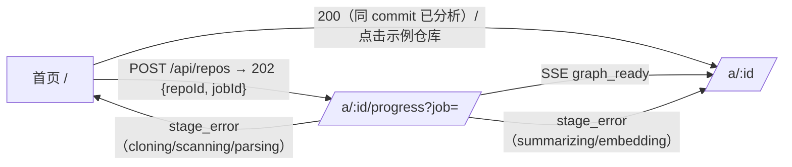

# 可视化代码仓库分析 —— 前端与交互设计文档

> 版本：v1（2026-10-29）。技术栈：Next.js 15 App Router + React 19 + TypeScript + Zustand + Tailwind + React Flow（@xyflow/react）+ elkjs。
> 第 1 周只支持 TypeScript 仓库。接口以总方案 `architecture/ARCHITECTURE.md` §5 为准；本文与总方案不一致的地方见 7.4。

## 1. 设计目标与范围

**目标**：用户输入一个 GitHub 仓库地址后，几十秒内看到可交互的依赖图，并能用自然语言提问。答案中的每条引用都能在图上和代码中定位，「答案可溯源」是核心卖点。

| 范围 | 内容 |
|---|---|
| MVP（W1–W3） | TS 仓库导入（W1 只做 TS，非 TS 仓库在提交时就拦截）；SSE 解析进度；dir/module/file 三层依赖图，支持折叠和展开；文件树与过滤；节点详情与代码预览；流式问答，引用与图高亮联动；暖色纸感浅色主题（默认，深色可选，见第 8 章）；预解析示例仓库：zustand、hono、zod，备选 trpc |
| 加分项（W4 及以后） | 循环依赖检测与标红；两个 commit 的图 diff；路径查询（A 如何依赖 B）；导出 PNG/SVG；多语言（tree-sitter）；分享链接（URL 记录视图状态）；小地图 |
| 不做 | 在线编辑代码、私有仓库 OAuth（W4 之后再考虑）、移动端完整工作台（只提供只读视图） |

**体验指标**：首屏 TTI 小于 2 秒；画布累计 1,500 节点（已开启边抽稀）时交互 FPS 不低于 45；从点击引用到节点聚焦小于 300 ms；第一个 token 在 1.5 秒内出现（不计 LLM 自身延迟）。

## 2. 页面结构与路由

```
app/
├─ (home)/page.tsx               # 首页：输入仓库 URL + 示例仓库卡片
├─ a/[id]/
│  ├─ layout.tsx                 # 工作台三栏布局 + 顶栏（id = repoId，与总方案 §9 一致）
│  ├─ page.tsx                   # 主工作台；URL 参数 ?node=&q= 用于记录视图状态
│  └─ progress/page.tsx          # 分析进度页（?job=<jobId>，订阅 /api/jobs/:jobId/events）
└─ api/ (由后端提供，前端只调用)
```

流程：



主工作台线框：

```
┌──────────────────────────────────────────────────────────────────────┐
│ ◆ RepoLens   honojs/hono @a1b2c3  [搜索节点 ⌘K]   层级: Dir▸Mod▸File  ⚙ │
├──────────────┬──────────────────────────────────────┬────────────────┤
│ 文件树/过滤   │             依赖图 (React Flow)       │ [详情] [对话]   │
│ ▸ src/       │      ○core ───▶ ○utils                │ 节点: src/core  │
│   ▸ core (42)│        ╲         ▲                    │ 类型 module      │
│   ▸ utils    │         ▶ ○hooks ┘                    │ 入度 12 出度 5   │
│ ☑ 隐藏 test  │                                       │ ─ 代码预览 ─     │
│ ☑ 隐藏 node_ │                                       │ 1 export ...     │
│ 搜索: [    ] │   [+][-][⤢适配] [重新布局 ↻]   小地图   │ ─ 对话 ─         │
│ 边类型 ☑imp  │                                       │ Q: 数据怎么缓存? │
│              │                                       │ A: ...[1][2]     │
├──────────────┴──────────────────────────────────────┴────────────────┤
│ 状态栏: 当前显示 1,284 节点 / 3,902 条边 · 已折叠到 module 层 · FPS 60           │
└──────────────────────────────────────────────────────────────────────┘
```

线框说明：页面为米白纸色底（`--bg`），三栏之间只用 1px 细线（`--border`）分隔，不加厚重面板色；中间图区用稍深的暖灰底（`--canvas`）以衬托白色节点卡片；右栏对话为阅读式排版（见第 8 章）。顶栏左侧是 RepoLens 自己的名称和图标。

组件树：

```
<WorkspaceLayout>
├─ <TopBar> (RepoBadge, CommandPalette, LevelSwitcher, Settings)
├─ <ResizablePanels>
│  ├─ <LeftPanel>
│  │  ├─ <FileTree virtualized />        # react-arborist / 自研虚拟列表
│  │  └─ <FilterBar> (Search, ExcludeGlobs, EdgeKindToggle, DepthSlider)
│  ├─ <GraphPanel>
│  │  ├─ <GraphCanvas />                 # dynamic(ssr:false) 包裹 ReactFlow
│  │  ├─ <GraphToolbar /> <MiniMap /> <NodeTooltip /> <ContextMenu />
│  │  ├─ nodeTypes: <ModuleCard /> <DirNode /> <FileNode /> <ExternalNode />（均 React.memo）
│  │  ├─ edgeTypes: <WeightedEdge />
│  │  ├─ <CytoscapeFallback />           # 累计节点 >2000 或性能不足时切换
│  │  └─ <LayoutWorkerBridge />
│  └─ <RightPanel tabs>
│     ├─ <NodeDetail> (Meta, Neighbors, CodePreview[Shiki])
│     └─ <ChatPanel> (MessageList, CitationChip, ContextChips, Composer)
└─ <StatusBar />
```

首页由 `<RepoInput>`（URL 校验 + 语言预检提示）和 `<SampleRepoGrid>` 组成。仓库地址输入框下方用次要文字（`text-muted`）常驻一行提示：「只支持公开仓库。源码内容会发送给第三方模型服务。」提交失败时，表单下方的 `role="status"` 行显示错误码对应的中文文案（`lib/api/errors.ts` 的 `ERROR_TEXT`），不跳转；其中私有仓库返回 422 `REPO_NOT_PUBLIC`，显示「只支持公开仓库。」，与上面的常驻提示同一措辞，不会被当成网络错误。进度页包含 `<StageStepper stages=[queued,cloning,scanning,parsing,graph_ready,summarizing,embedding,done]>`、`<ProgressBar>`、`<LogTail>`（最近 20 条 message），以及 `<StageErrorCard stage message>`。收到 `graph_ready` 后立即跳到工作台；摘要和向量化在后台继续，工作台顶栏用 `<BackgroundProgress>` 小进度条显示 summarizing/embedding 的进度。

## 3. 依赖图渲染选型

| 维度 | **React Flow（@xyflow/react v12）** ✅ 采用 | Cytoscape.js（回退） | Sigma.js v3 + graphology（可选方案） |
|---|---|---|---|
| 渲染 | DOM/SVG（节点是 React 组件，边是 SVG） | Canvas 2D | WebGL |
| 可流畅交互的规模 | 约 1–2k 节点（开启 `onlyRenderVisibleElements` + memo 节点） | 约 2–5k 节点 | 1–10 万节点/边 |
| 节点外观 | 任意 React 组件：可做带标题、摘要、指标的「模块卡片」 | 选择器样式，图形有限 | 需写 WebGL program，定制成本高 |
| 布局 | 不内置，接 elkjs（worker） | 内置 fcose/dagre，也可接 elk | 不内置，可接 elkjs |
| React / Next.js 集成 | 原生 React，hooks + 受控 state，最自然 | react-cytoscapejs（维护一般），命令式 API | @react-sigma/core，命令式 |
| SSR | 需要 `dynamic(..., { ssr: false })` | 同左 | 同左 |
| 定位 | 主渲染器 | 累计节点 >2000 或性能不足时回退 | 只在文件级超大图（>1 万）时考虑，W1–W4 不实现 |

**结论：采用 React Flow + elkjs**（与总方案 §3 一致）。理由：
1. **规模可控，DOM 渲染可行**：后端单次只返回 ≤300 个节点的聚合层，file 层靠 `?parentId=` 懒加载，正常使用时画布在几百到 1,500 节点之间。在这个量级，DOM 渲染配合视口裁剪和 memo 足够流畅，不需要 WebGL。
2. **演示观感**：自定义节点卡片（模块名、摘要首句、文件数、入度/出度）看起来像一张「交互式架构图」，而不是一团点线，演示冲击力更强。
3. **集成最自然**：节点就是 React 组件，可直接复用 Tailwind、Zustand selector、Tooltip、ContextMenu；与 Next.js App Router 的客户端组件模型一致。
4. **布局解耦**：所有层级的坐标都由 elkjs 在 worker 中确定性计算（第 4.5 节），渲染库只负责绘制，因此切到 Cytoscape 回退时可以复用同一份坐标。

**回退**：累计节点超过约 2000，或实测 FPS 持续低于 30 时，提示用户「切换到高性能模式」，用 Cytoscape（Canvas）渲染同一份 nodes/edges/positions。渲染层通过 `GraphRenderer` 接口隔离（`setData / setPositions / highlight / focus`），React Flow 与 Cytoscape 各实现一份。**Sigma.js + graphology** 只作为「文件级超大图」的可选方案记录在本表，不实现。

Next.js 集成要点：

```tsx
// components/graph/GraphCanvas.tsx
import dynamic from "next/dynamic";
export const GraphCanvas = dynamic(() => import("./FlowGraph"), {
  ssr: false,                        // 依赖 window/ResizeObserver，关闭 SSR
  loading: () => <GraphSkeleton />,
});
export const CytoscapeFallback = dynamic(() => import("./CytoscapeGraph"), { ssr: false });

// FlowGraph.tsx（"use client"）
import { ReactFlow, ReactFlowProvider, MiniMap, Background } from "@xyflow/react";
import "@xyflow/react/dist/style.css";
const nodeTypes = { module: ModuleCard, dir: DirNode, file: FileNode, external: ExternalNode }; // 模块级常量，避免每次渲染重建
const edgeTypes = { weighted: WeightedEdge };
export default function FlowGraph() {
  const nodes = useStore(s => s.flowNodes), edges = useStore(s => s.flowEdges);
  return (
    <ReactFlowProvider>
      <ReactFlow nodes={nodes} edges={edges} nodeTypes={nodeTypes} edgeTypes={edgeTypes}
        onlyRenderVisibleElements nodesDraggable={false} nodesConnectable={false}
        minZoom={0.05} maxZoom={2} fitView proOptions={{ hideAttribution: true }}
        onNodeClick={onNodeClick} onNodeDoubleClick={onNodeDoubleClick} onNodeContextMenu={onContextMenu}>
        <Background gap={24} /> <MiniMap pannable zoomable />
      </ReactFlow>
    </ReactFlowProvider>
  );
}
```

- 自定义节点全部 `React.memo`，props 只传 `id` 和 `data`；高亮等视图状态由节点内部用 Zustand selector 订阅自己的 id（`useStore(s => s.highlight.get(id))`），选中变化时只重渲染受影响的节点。
- 相机控制用 `useReactFlow()` 的 `setCenter / fitBounds / fitView`。

## 4. 大图性能策略

### 4.1 节点规模策略：聚合层 + 懒加载 + 画布累计上限

总方案 §5.2 规定：单次返回的节点数不超过 300。前端不再按仓库总节点数分档，统一采用下面这一套策略：

| 环节 | 规则 |
|---|---|
| 首次加载 | `GET /api/repos/:id/graph`（不传 parentId）返回顶层，节点数不超过 300；超过时后端按聚合层（dir → module）继续上卷。范围外的边聚合为 `type:"imports"`、`aggregated:true`、带 `weight` 的边 |
| 展开 | 点击 module/dir 卡片上的 ▸（双击卡片为附加快捷方式；单击卡片主体只选中，不展开）后请求 `?parentId=<nodeId>`，得到该节点的直接子节点（不超过 300 个）和相关边，合并进画布（见 4.3） |
| 画布累计上限 | 以**已展开的累计节点数**计：超过 800 时开启边抽样（4.6）并只显示重点标签；超过 1,500 时弹出提示「画布节点过多，建议收起部分模块」，并提供「一键收起到 module 层」按钮。前端不强制截断 |
| 布局 | 所有层级（dir/module/file）都用 elkjs 计算，在 web worker 中运行（见 4.5）；示例仓库读取预计算的布局文件 |
| 标签 | 累计 ≤300 时全部显示；超过 300 后按缩放比例和度数 top-N 显示 |

> 演示提示：zod、hono 的文件数可能不到数千，「大图折叠」这一镜的效果需要实测。默认让 zod 只展示 module 层，演示前实测节点数，并调整累计提示阈值（见第 9 章检查项）。

### 4.2 目录折叠聚合

```ts
// 把 file 级边聚合到当前可见祖先之间
function aggregateEdges(raw: GraphEdge[], visibleAncestor: (id: string) => string) {
  const map = new Map<string, { source: string; target: string; weight: number }>();
  for (const e of raw) {
    const s = visibleAncestor(e.source), t = visibleAncestor(e.target);
    if (s === t) continue;                       // 内部边折叠后不画
    const k = `${s}->${t}`;
    const cur = map.get(k) ?? { source: s, target: t, weight: 0 };
    cur.weight++; map.set(k, cur);
  }
  return [...map.values()];
}
```

- `visibleAncestor` 沿 `parentId` 向上查找，直到遇到第一个「展开集合」以外的祖先。展开状态 `expanded: Set<string>` 存在 store 中。
- 聚合节点显示 `childCount` 徽标，节点大小按子孙文件数取 sqrt 映射。

### 4.3 按需展开（懒加载）

- 点击 module/dir 的 ▸（或双击卡片）展开时，如果子节点还没加载，请求 `GET /api/repos/:id/graph?parentId=<nodeId>`（例如 `?parentId=m:src/utils`、`?parentId=d:src/utils/jwt`）。返回该父节点的直接子节点和相关边，格式同样是 `{nodes, edges, meta}`；指向范围外的边由后端聚合为一条带 `weight` 的边。
- 新子节点的目标坐标由 elkjs 计算（worker 中运行，已有节点作为固定约束，避免整张图跳动；示例仓库直接从布局文件读取）。从父节点位置移动到目标坐标的过程是约 300 ms 的坐标插值动画（rAF 更新 position，ease-out），不跑力导向布局。
- 请求结果用 TanStack Query 缓存，key 为 `["graph", repoId, commitSha, parentId]`。图数据按 commitSha 缓存。

### 4.4 LOD 与渲染裁剪（React Flow）

- **视口裁剪**：开启 `onlyRenderVisibleElements`，视口外的节点和边不进 DOM。
- **memo 自定义节点**：`ModuleCard / DirNode / FileNode / ExternalNode / WeightedEdge` 全部 `React.memo`，`nodeTypes`、`edgeTypes` 定义在模块顶层；拖拽与连线关闭（`nodesDraggable={false}`）。
- **按缩放分级**（`useStore(s => s.transform[2])` 读 zoom）：zoom < 0.5 时 ModuleCard 只显示标题、隐藏摘要；zoom < 0.3 时隐藏 file 标签，边改为细线并降低透明度；zoom < 0.15 时自动收起到 dir 层，这一项**默认关闭**，只能在设置中手动开启。
- **按累计节点数分级**：累计节点 >800 时开启边抽稀（4.6）和标签精简（只显示度数 top-N 的标签）；>1,500 时提示「画布节点过多，建议收起部分模块」，提供「一键收起到 module 层」；>2,000 或 FPS 持续 <30 时，额外提供「切换到高性能模式（Cytoscape）」。
- 平移或缩放过程中（`onMoveStart`/`onMoveEnd`）临时隐藏边标签和 hover tooltip。

### 4.5 布局算法（统一 elkjs，全部在前端计算，坐标不进服务端数据）

- **所有层级都用 elkjs**：dir、module、file 三层都使用 `elkjs` 的 `layered` 算法（方向 `RIGHT`，`elk.layered.considerModelOrder` 开启，保证确定性），通过 `apps/web/lib/layout/elk.worker.ts`（worker 内跑 `elkjs/lib/elk.bundled.js`，postMessage 收发）在 web worker 中运行，不阻塞主线程。同样的输入总是得到同样的坐标，所以可以缓存、预计算和对比。
- 所有坐标都来自 elkjs；展开新节点时只做约 300 ms 的坐标插值过渡（见 4.3），不使用力导向布局。
- 性能兜底：单次 elkjs 布局超过 2 秒时，退回 elk 的 `mrtree` 或简单网格布局并提示（总方案的降级是 dagre，二者择一，W1 实测后定）。
- **示例仓库**（zustand、hono、zod、trpc）：commitSha 在部署脚本中固定。前端脚本 `scripts/gen-layout.ts` 离线用 elkjs 生成布局文件 `apps/web/public/layouts/{owner}-{repo}-{commitSha}.json`（命名以总方案 §5.2 为准），结构为 `{ commitSha, positions: { [nodeId]: [x, y] } }`。布局文件与图数据分开存放，不进服务端，也不依赖任何服务端布局字段。演示时直接读取，同时写入 IndexedDB 预热缓存（key 为 `commitSha + nodeId`）。
- **commitSha 校验**：加载布局文件时比对图数据的 `meta.commitSha`。不一致就丢弃布局文件、退回 elkjs 实时计算，并在控制台告警：`console.warn("[layout] commitSha mismatch", { file, graph })`。
- 非示例仓库一律在现场用 elkjs 计算。

### 4.6 边抽样与隐藏

- 聚合后的边数超过 3×可见节点数时，每个节点只保留权重 top-K 的出边（K=5），其余边设为 `hidden`。状态栏提示「已隐藏 N 条弱边」，可以一键显示全部。
- 接口不下发父子包含边，父子关系由 `parentId`、折叠和颜色表达；`external` 节点的边默认隐藏。
- 选中节点时，强制显示它的全部一跳边（包括被抽样隐藏的边）。

### 4.7 布局缓存

- 统一用 IndexedDB（idb-keyval），以 `commitSha + nodeId` 为 key，存 `[x, y]`。nodeId 由路径确定性生成（`m:src/core`、`d:src/core/util`、`f:src/a.ts`），同一 commit 内稳定，所以缓存可以复用，分享链接也可靠。
- 非示例仓库：二次打开时，有缓存的节点直接使用缓存坐标，只对新节点跑 elkjs。
- 示例仓库：首次打开时把布局文件的坐标写入 IndexedDB 做预热，之后与非示例仓库走同一条读取路径。

## 5. 点击节点详情

| 交互 | 行为 |
|---|---|
| hover（悬停 150 ms） | 显示 Tooltip：路径、类型、入度/出度、子文件数。file 节点额外显示前 8 行代码（来自缓存，不发请求） |
| 单击 | 选中节点：节点本身和一跳邻居高亮，其余节点淡出到 15% 透明度；右栏切到「详情」；文件树同步滚动定位；URL 写入 `?node=` |
| ▸ / ▾ 箭头 | 聚合节点展开或收起（4.3）的主入口，也是键盘可达的按钮（`aria-expanded`） |
| 双击 | 附加快捷方式：module/dir 展开或收起（同 ▸）；file 节点在右栏打开完整代码预览（后续） |
| 右键 | 上下文菜单：展开/收起、只看此子图（focus mode）、查找依赖路径到…、复制路径、在 GitHub 打开、加入对话上下文 |
| Shift + 单击 | 多选，用于多节点上下文或路径查询 |
| Esc / 点击空白 | 取消选中，恢复全图 |

> T-004 已实现：单击选中（选中节点 `--accent-strong` 2px 描边 + 引用高亮底色，一跳邻居保持不透明，相连边加粗并改用 `--accent-strong`，其余节点/边淡出到 15%，展开后的容器不淡出）、▸ 与双击展开、Esc/点击空白取消。右栏详情尚未实现，暂由左下状态条显示所选节点路径与依赖/被依赖条数；`?node=`、文件树联动、Shift 多选未实现。

> T-222 已实现右栏 `<NodeDetail>`（`apps/web/components/detail/NodeDetail.tsx`）：调用 `GET /api/repos/:id/nodes/:nodeId`，显示面包屑、类型、摘要、LOC/入度/出度、导出符号、`topDependents`，以及当前图中可见层级的一跳依赖/被依赖（接口本身只返回 `topDependents`）。列表项可点击跳转：目标未加载时按 suggestedFocus 同一套逐层展开后再选中。摘要为 `null` 时显示骨架并在 `done` 后重新请求，空字符串显示「暂无摘要」；（T-222e 起按 `summarySource` 区分规则摘要和模型摘要，见下文「摘要来源与在环中」。）切换节点时取消旧请求并丢弃过期响应；`?node=` 已写入 URL，进入页面时会读取。`inCycle` 已在 T-222e 实现；文件树联动、「问问这个模块」仍未实现。

详情面板内容（`<NodeDetail>`）：
- 头部：图标 + 路径面包屑（可点，用于跳转父节点）+ 类型标签。
- 摘要：LLM 生成的 `summary`。为 `null`（摘要还没生成，后台仍在 summarizing）时显示 3 行骨架屏，收到 `done` 进度事件后重新请求。
- 指标：LOC、导出符号、入度/出度、`topDependents`（被依赖最多的节点，可点击跳转）、是否处于循环依赖中（加分项，来自节点详情接口的 `inCycle`；图状态不再收集 `meta.cycles`，T-203）。
- 邻居列表：「依赖于」和「被依赖」两个 tab，各自可点击跳转。
- 代码预览：Shiki（浅色用 `github-light` 叠加纸色底，深色用 `vitesse-dark`，见第 8 章），懒加载，`GET /api/repos/:id/files?path=&start=&end=`；支持行区间高亮（与引用共用）；超过 2,000 行时用虚拟滚动。
- 操作：「问问这个模块」，点击后把节点加入对话上下文并切换到对话 tab。

```ts
// GET /api/repos/:id/nodes/:nodeId（总方案 §5.1），用 TanStack Query 按 nodeId 缓存
interface NodeDetail {
  id: string;                         // 例如 "f:src/compose.ts"
  kind: "module" | "file" | "external";
  path: string;
  summary: string | null;             // null 表示摘要还没生成，显示骨架屏
  summarySource: "llm" | "rule" | null; // T-211c:摘要来源;summary 为 null 时为 null
  exports: string[];
  loc: number;
  inDegree: number;
  outDegree: number;
  topDependents: string[];            // nodeId 列表
  inCycle: boolean;                   // T-211c:在某个 SCC 成员集合中(module 看其下文件)
}
```

> **T-222d 详情面板收尾**（#43 评审的非阻塞后续）：
> - **窄屏抽屉**：视口 ≥768px（Tailwind `md`）时详情仍是 360px 右栏；<768px 时未选中节点不显示详情区（图占满），选中后详情变为占下方 55dvh 的底部抽屉（T-222e 起用 `55dvh`，移动端浏览器地址栏收起/展开时按动态视口计算，不会被地址栏挡住一截）。抽屉在文档流内（工作区改为 `flex-col md:flex-row`），图区随之缩到上方而不是被盖住；图区尺寸变化时 `ResizeObserver` 防抖 150ms 后 `fitView`。抽屉顶部「关闭」按钮通过 `GraphView` 的 `clearRequest` 取消选中，与 Esc、点空白一致（`?node=` 随之从 URL 去掉）。窄屏隐藏图例（否则盖住约一半图区）。
> - **折叠后不保留旧详情**：选中节点因所在目录被折叠或「全部收起」而不在画布上时，清除选中并关闭详情（回调 `onSelectionChange(null)`）。没有选「标注该节点当前未显示」：状态栏和高亮都以画布为准，面板单独显示一个看不到的节点会让「依赖于（图中可见层级）」列表与画面对不上；需要时可从面包屑或 `?node=` 再跳回去，跳转会自动展开。唯一例外是外部跳转进行中（`pendingJump` 非空，含 `?node=` 首次打开），这时节点暂不可见是正常的，保持原状态，因此 #43 的深链接逻辑不变。
> - 同时修正一个潜在问题：选中回调曾写成 `return onSelectionChange(null)`，若回调有返回值会被 React 当作 effect 清理函数调用而报错。
> - 真实浏览器验证（Chromium/Playwright，hono 本地数据，`LLM_PROVIDER=fake`）截图：`docs/assets/T-222d/desktop-detail.png`、`desktop-after-collapse.png`、`narrow-drawer.png`（390×844）、`narrow-closed.png`。Safari、Firefox、深色模式未验证。

## 6. 对话与图高亮联动

### 6.1 SSE 事件处理

```ts
type ChatErrorCode = "LLM_UNAVAILABLE" | "BUDGET_EXCEEDED" | "REPO_NOT_READY" | "RATE_LIMITED";
type ChatEvent =
  | { type: "tool"; name: string; args: Record<string, unknown> }      // 可选：显示「正在读取 xxx.ts」
  | { type: "token"; text: string }
  | { type: "citation"; id: number; path: string; startLine: number; endLine: number; nodeId: string; moduleId?: string } // 只会收到已校验的引用
  | { type: "done"; messageId: number; droppedCitations: number; fallback?: "retrieval"; usage: { in: number; out: number } }
  | { type: "error"; code: ChatErrorCode; message: string; retryable: boolean };  // 替代 done，之后流立即结束

const CLIENT_TIMEOUT_MS = 20_000;   // 前端兜底：20 秒内既没有 token，也没有 done/error

async function chat(repoId: number, sessionId: number, message: string, contextNodeIds: string[], signal: AbortSignal) {
  const s = useStore.getState();
  s.startAnswer();                     // 统一进入 thinking：显示「正在思考…」，第一个 token 到达即切为正文
  let timer = setTimeout(() => s.timeoutAnswer(), CLIENT_TIMEOUT_MS);
  await fetchEventSource(`/api/repos/${repoId}/chat`, {
    method: "POST", body: JSON.stringify({ sessionId, message, contextNodeIds }), signal,
    onmessage(ev) {
      const data = JSON.parse(ev.data);
      if (ev.event === "tool") s.setToolHint(data.name, data.args);
      else if (ev.event === "token") { clearTimeout(timer); s.appendToken(data.text); }
      else if (ev.event === "citation") s.addCitation(data);
      else if (ev.event === "done") { clearTimeout(timer); s.finish(data); }
      else if (ev.event === "error") { clearTimeout(timer); s.failAnswer(data); }   // 不会再收到 done
    },
    onerror(err) { clearTimeout(timer); s.failAnswer({ code: "NETWORK", message: String(err), retryable: true }); throw err; },
  });
}
```

**「正在思考…」状态（所有问题统一）**：发出问题后，前端一律显示「正在思考…」：一块纸面骨架（3 行浅色 shimmer）加一个缓慢呼吸的小圆点动画；收到第一个 `token` 立即切换为正文。前端不判断问题类型，也不新增任何事件。
- 定位类问题（「在哪个文件/哪几行」）由后端缓冲整段答案、校验引用后再一次性下发 `token` 和 `citation`，对前端来说只是「思考」时间更长；非定位类问题照常流式，「思考」状态很短。
- 收到 `tool` 事件时，在骨架下方用小字显示「正在读取 src/compose.ts」。
- 后端缓冲加重试的总耗时上限约 15 秒，超时直接走 `fallback:"retrieval"`。前端另设 20 秒兜底：超过 20 秒还没有任何 token，也没有 `done`/`error`，就主动 abort，并显示「回答超时，请重试」和重试按钮。

**error 事件按 code 区分提示**：

| code | 提示文案 | 重试按钮（看 `retryable`） | 其他 |
|---|---|---|---|
| `LLM_UNAVAILABLE` | 模型服务暂时不可用 | 通常有 | 示例仓库可展示检索片段或缓存答案 |
| `BUDGET_EXCEEDED` | 今日额度已用完，明天再试 | 通常没有 | 禁用输入框，并显示原因 |
| `REPO_NOT_READY` | 仓库还在分析中（摘要/索引未完成） | 有 | 顶栏小进度条高亮，完成后提示可以提问 |
| `RATE_LIMITED` | 提问太频繁，请稍后 | 有，倒计时 10 秒后才可点 | — |

是否显示重试按钮一律以 `retryable` 为准，表里只是常见情况。

### 6.2 流式展示

- token 每 16 ms 合并一次再写入 store（rAF 节流），Markdown 增量渲染（react-markdown + 未闭合代码块容错）。
- citation 到达时，在当前答案末尾追加编号角标 `[n]`。卡片区实时新增 `<CitationChip>`，同时对应节点做一次「脉冲」提示（不移动相机，避免流式过程中画面乱跳）。
- `done` 后启用「聚焦全部引用」按钮，相机 fit 到所有引用节点的包围盒。

### 6.3 点击引用聚焦节点

1. 通过 `nodeId` 查找节点。如果它被折叠，沿 `parentId` 链路逐级展开，必要时触发懒加载。
2. 画布 `setCenter(x, y, { zoom: 1.2, duration: 400 })`（`useReactFlow()`）。
3. 选中该节点，并在右栏代码预览中滚动到 `startLine–endLine` 并高亮。
4. 前端只处理已校验的引用。后端会直接丢弃没通过校验的引用，前端不需要为这类引用做任何特殊展示。

### 6.3.1 done 事件的附加提示
- `droppedCitations > 0`：在该条消息底部用小字（12px，`--text-3`）显示「已过滤 N 条无法校验的引用」。
- `fallback === "retrieval"`：模型给出的引用全部没通过校验，后端改用检索得到的 top-3 片段作为 citation 下发。这些引用的交互与普通引用一样，但要在该回答下方加一个小标签「引用来自检索结果」（灰底胶囊样式，悬浮时解释来源）。
- 回答结束后如果一条引用都没有（没有 citation 事件，也没有 fallback），图上不做任何高亮，也不显示「聚焦全部引用」按钮。

### 6.4 图选中节点作为对话上下文

- 右键「加入对话上下文」、多选，或在详情面板点「问问这个模块」，都会在 Composer 上方显示 `<ContextChip>`（可删除，最多 5 个）。
- 请求体带 `contextNodeIds`，后端优先检索这些节点。Composer 的 placeholder 变为「关于 src/core 提问…」。

### 6.5 高亮视觉规范

| 状态 | 节点 | 边 | 动画 |
|---|---|---|---|
| 选中 | 3px `--accent-strong` 描边 + 放大 1.06 倍 | 一跳边不透明度 100%，颜色 `--text-2` | 150 ms 缩放 |
| 邻居 | 原色，不透明度 100% | 同上 | — |
| 引用命中 | 3px `--accent-strong` 描边 + 8px `--accent` 柔光（30% 不透明度） | — | 到达时柔光淡入淡出 2 次，每次 700 ms |
| 淡出 | 不透明度 25%，标签隐藏 | 不透明度 10% | 200 ms 渐变 |

开启 `prefers-reduced-motion` 时，所有脉冲和相机动画改为瞬时完成。

## 7. 状态管理与前后端接口

### 7.1 Zustand store 切片

```ts
// store/index.ts：使用 slices pattern，一个 store 加多个 slice，subscribeWithSelector
type Stage = "queued" | "cloning" | "scanning" | "parsing" | "graph_ready" | "summarizing" | "embedding" | "done";
interface RepoSlice   { repoId?: number; commitSha?: string; meta?: GraphMeta; setRepo(m: GraphMeta): void }
interface JobSlice    { jobId?: string; stage?: Stage; progress: number; logs: string[];
                        graphReady: boolean;                       // graph_ready 后为 true，可以出图
                        stageError?: { stage: Stage; message: string };
                        onProgress(e: { stage: Stage; progress: number; message?: string }): void;
                        onGraphReady(e: { repoId: number; graphUrl: string }): void;
                        onStageError(e: { stage: Stage; message: string }): void }
interface GraphSlice  { level: "dir" | "module" | "file"; expanded: Set<string>; loadedParents: Set<string>;
                        hiddenEdgeCount: number; renderer: "flow" | "cytoscape";
                        positions: Map<string, [number, number]>; highlight: Map<string, HighlightState>;
                        toggleExpand(id: string): Promise<void>; setLevel(l: Level): void; setRenderer(r: "flow" | "cytoscape"): void }
interface SelectSlice { selected: string[]; hovered?: string; focusMode?: string;
                        select(id: string, additive?: boolean): void; clear(): void }
interface FilterSlice { search: string; excludeGlobs: string[]; edgeKinds: EdgeKind[]; hideTests: boolean }
// ChatMessage: { id; messageId?: number; role; content; citations: Citation[]; status: "thinking" | "streaming" | "done" | "error";
//               toolHint?: string; droppedCitations: number; fallback?: "retrieval"; error?: ChatError }
interface ChatSlice   { sessionId?: number; messages: ChatMessage[]; contextNodeIds: string[];
                        startAnswer(): void; setToolHint(name: string, args: unknown): void;
                        appendToken(t: string): void; addCitation(c: Citation): void;
                        finish(d: { messageId: number; droppedCitations: number; fallback?: "retrieval" }): void;
                        failAnswer(e: ChatError): void; timeoutAnswer(): void; retry(localId: string): void }
interface UiSlice     { rightTab: "detail" | "chat"; panelSizes: [number, number, number]; online: boolean }

type AppState = RepoSlice & JobSlice & GraphSlice & SelectSlice & FilterSlice & ChatSlice & UiSlice;
```

- 图相关状态：`GraphSlice` 保存 `rawNodes / rawEdges`（按 parentId 合并后的服务端数据）、`positions: Map<nodeId,[x,y]>`（elkjs 结果）和 `expanded`；派生出 React Flow 需要的 `flowNodes / flowEdges`（只包含当前可见层，边已按 4.2 聚合、按 4.6 抽稀），用 selector + `shallow` 订阅，只有可见集合变化时才重新计算。
- 高亮状态单独放在 `highlight: Map<nodeId, "selected"|"neighbor"|"cited"|"dimmed">`，由节点组件按自己的 id 订阅，不改写 `flowNodes`，避免整张图重渲染。
- `renderer: "flow" | "cytoscape"` 记录当前渲染器；切换时复用同一份 nodes/edges/positions。
- 持久化：`UiSlice.panelSizes`、`FilterSlice` 存 localStorage；`selected`、`expanded` 同步到 URL，用于分享。
- 服务端数据（图分片、文件内容、节点详情）用 TanStack Query 管理，不进 Zustand。

### 7.2 接口清单（以总方案 §5.1 为准）

| 接口 | 说明 |
|---|---|
| `POST /api/repos` `{repoUrl, ref?}` | `202 {repoId, jobId, status:"queued", repo, commitSha}`；同一 repo 和 commit 已分析过时返回 `200`（直接进入工作台）；非 TS 仓库返回 `422 {error:{code:"UNSUPPORTED_LANGUAGE", message}}` |
| `GET /api/repos/:id` | 仓库和最近一次任务的状态 `{stage, progress, stats, error}`，SSE 降级轮询时使用 |
| `GET /api/repos?repo=owner/name` | 查询已有分析（首页示例卡片命中缓存时使用） |
| `GET /api/jobs/:id/events` (SSE) | `progress {jobId, stage, progress, message}` / `graph_ready {jobId, repoId, graphUrl}` / `stage_error {jobId, stage, message}` / `done {jobId, status, stats}`；支持 `Last-Event-ID` 续传 |
| `GET /api/repos/:id/graph[?parentId=m:src/core][&includeExternal=true]` | 返回 `{nodes, edges, meta}`，单次不超过 300 个节点；带 parentId 时返回直接子节点和相关边，范围外的边聚合为 `aggregated:true` 边；`x:` 外部节点只在 `includeExternal=true` 时返回 |
| `GET /api/repos/:id/nodes/:nodeId` | 节点详情（见第 5 章 `NodeDetail`） |
| `GET /api/repos/:id/files?path=&start=&end=` | 读取文件片段，用于代码预览 |
| `POST /api/repos/:id/chat` (SSE) | 请求体 `{sessionId, message, contextNodeIds?: string[]}`；事件 `tool?` / `token` / `citation` / `done`，出错时用 `error` 替代 `done` |

### 7.3 依赖图数据结构（GraphData）

**唯一来源是 `packages/shared/src/graph.ts`（zod schema + 推导类型），前端直接 `import { GraphDataSchema, type GraphData } from '@repolens/shared'`，不在前端重复定义。** 下面只是摘要，有出入时以 shared 为准。

```ts
// 节点字段平铺（不嵌套 data）
type GraphNode =
  | { id: `m:${string}`; type: 'module'; parentId: null; label; path; weight?; loc?; summary? }
  | { id: `d:${string}`; type: 'dir'; parentId: `m:${string}` | `d:${string}`; label; path; ... }
  | { id: `f:${string}`; type: 'file'; parentId: `m:${string}` | `d:${string}`; label; path; externalDeps?: string[]; ... }
  | { id: `x:${string}`; type: 'external'; parentId: null; label; path };   // 派生，默认不返回
type GraphEdge = {
  id; source; target;
  type: 'imports';
  kind: 'static' | 'dynamic' | 'type-only' | 're-export' | 'require';
  srcFileId: `f:${string}`;   // 聚合边保留一个代表源文件
  weight: number;             // 正整数；聚合边 = 被合并的 import 次数之和
  aggregated?: true;          // 派生：端点被上卷到祖先时由 API 层生成
};
type GraphData = { nodes: GraphNode[] /* ≤300，id 唯一 */; edges: GraphEdge[]; meta: { repoId; commitSha /* 7–40 位小写 hex */; parentId: string | null; language: 'typescript'; cycles? } };
// 不含 x/y 和 meta.layout：布局由前端用 elkjs 计算
```

- 层级固定为 **module → dir → file**。id 为前缀 + POSIX 相对路径（`m:src/utils`、`d:src/utils/jwt`、`f:src/utils/url.ts`），非 external 节点要求 `id.slice(2) === path`。仓库根目录的散落文件归入 `m:.`。
- module 划分：有 workspace 时每个 workspace 包根是一个 module；否则 `src/` 下每个一级目录是一个 module；其余归 `m:.`。
- 聚合边、`x:` 外部节点都是 API 层的派生数据，存储层不保存；`x:` 节点和外部边只在 `?includeExternal=true` 时返回。
- 子节点数由前端在加载子级后统计，接口不提供 `childCount`。边的样式按 `kind` 和 `aggregated` 区分（见第 8 章）。

前端在运行时用同一个 `GraphDataSchema` 校验接口返回，校验失败时上报错误并显示错误卡片。

### 7.4 与总方案的对齐点（已对齐 ✅，以 ARCHITECTURE.md 为准）

1. 问答接口：`POST /api/repos/:id/chat`（SSE），请求体为 `{sessionId, message, contextNodeIds?}`。
2. 创建任务：`POST /api/repos {repoUrl}`，返回 `{repoId, jobId, status, repo, commitSha}`；已分析过返回 200；非 TS 仓库返回 422 `UNSUPPORTED_LANGUAGE`。
3. 图接口：`?parentId=` 返回直接子节点和相关边；范围外的边聚合为 `type:"imports"` + `aggregated:true`，`weight` 累加，`kind` 取多数；单次不超过 300 个节点；`x:` 节点需 `includeExternal=true`；zod 默认只展示 module 层。
4. 图数据 schema 见 7.3（以 `packages/shared` 为准）：节点 `type` 为 module/dir/file/external，`weight`、`loc`、`summary` 可选，不含 `x/y` 和 `meta.layout`。
5. nodeId 由路径确定性生成（`m:src/core`、`f:src/a.ts`），同一 commit 内稳定；图数据按 commitSha 缓存；前端布局缓存的 key 为 `commitSha + nodeId`。
6. 布局：前端统一用 elkjs（worker 中运行）；展开时只做坐标插值动画，不用力导向布局。示例仓库固定 commitSha，布局文件为 `apps/web/public/layouts/{owner}-{repo}-{commitSha}.json`；加载时校验 commitSha，不一致就退回 elkjs，并在控制台告警。
7. 引用：只下发校验通过的 citation（`id, path, startLine, endLine, nodeId, moduleId?`）；`done` 带 `messageId`、`droppedCitations`、`fallback?: "retrieval"` 和 `usage {in, out}`。
8. 问答 `error {code, message, retryable}`，code 取 LLM_UNAVAILABLE、BUDGET_EXCEEDED、REPO_NOT_READY、RATE_LIMITED 之一；`error` 后流直接结束，不再发 `done`。另有可选的 `tool` 事件。
9. 进度：阶段固定为 queued → cloning → scanning → parsing → graph_ready → summarizing → embedding → done；事件为 `progress`、`graph_ready`（收到即可出图）、`stage_error {stage, message}`、`done`。节点详情接口为 `GET /api/repos/:id/nodes/:nodeId`。
10. 定位类问题不流式：后端缓冲并校验后一次性下发，前端没有撤回或替换逻辑；后端总耗时上限 15 秒，超时走 fallback；前端统一显示「正在思考…」，并设 20 秒兜底超时。

11. 渲染库：React Flow（@xyflow/react）+ elkjs，Cytoscape 为累计节点 >2000 或性能不足时的回退；Sigma.js + graphology 只作为文件级超大图的可选方案出现在第 3 章对比表中。
12. 演示：总长约 3 分钟，hono 主线，结尾 20 秒演示 MCP `ask_repo`。

前端新增、总方案未提及但不影响接口的行为：只有前端 20 秒兜底超时一项。

### 7.5 真实接口接入（T-007）

- **API 地址**：`NEXT_PUBLIC_API_BASE_URL`（构建期注入浏览器）；为空时同源请求 `/api/*`。后端未开 CORS，同源部署时设 `API_PROXY_TARGET`，由 Next rewrites 把 `/api/:path*` 转发到 api；`next.config.mjs` 设 `compress:false`，避免 gzip 缓冲 SSE。
- **部署（compose）**：`apps/web/Dockerfile` 以 `ARG API_PROXY_TARGET=http://api:4000` 在构建期注入，`docker-compose.yml` 的 web 构建通过 `args` 传入；`turbo.json` 的 build 任务声明了 `API_PROXY_TARGET` / `NEXT_PUBLIC_API_BASE_URL`（turbo 2 严格 env 模式否则会过滤掉，rewrites 为空）。运行时变量对 rewrites 无效。
- **直连另一个域名**：若改用 `NEXT_PUBLIC_API_BASE_URL` 指向别的域名，api 必须开 CORS，并通过 `Access-Control-Expose-Headers: x-graph-truncated` 暴露该头，否则浏览器读不到截断标记、截断提示会丢失。
- **调用**：`lib/api/client.ts` 的 `createRepo`（`POST /api/repos`）、`getRepoStatus`（`GET /api/repos/:id`）、`getGraph`（`GET /api/repos/:id/graph`）、`jobEventsUrl`。所有响应都先过 `@repolens/shared` schema（`CreateRepoResponseSchema` / `RepoStatusSchema` / `GraphDataSchema` / `ApiErrorSchema` / `JobEventSchema`），不合规按 `INVALID_RESPONSE` 处理。
- **图接口参数**：只带 `parentId`（根层不带任何参数）。后端对其它参数（缓存破坏 `_t=`、depth、level 等）一律返回 400，前端不得追加。
- **流程**：首页提交 → `/a/:repoId?job=…&repo=…` → 订阅 SSE `/api/jobs/:id/events`，进度面板按阶段（排队 / 克隆 / 扫描 / 解析 / 依赖图已生成）显示进度条与后端 message，进度只前进；`stage_error` 在对应阶段标 ✕ 并以 `role=alert` 显示；`graph_ready` 后取根层（module 层），双击 / ▸ 按 `parentId` 懒加载下一层；`done` 后关闭连接。直接打开链接（无 `job`）时先 `GET /api/repos/:id` 判断已完成、进行中或失败。
- **边界节点**：展开 P 的结果里 `node.parentId !== P` 的节点是聚合边的外端（#12），只当作已存在节点的占位：不加入状态、不渲染进 P、折叠 P 时不受影响；它们的边照常按可见祖先上卷。
- **分层边（#16 聚合边）**：每条边归属返回它的那一层（根层或某个 P）。只有根层和「已展开且可见」的层参与渲染；一端是已展开容器的边丢弃（由下一层的细粒度边/聚合边接替），两端都已展开的容器↔容器边保留。折叠 P 后其层的边留在缓存里不渲染，再次展开不重新请求。聚合边（`aggregated: true`）按 `weight` 加粗，weight>1 时显示 `×N`，悬停（SVG `<title>`）显示「聚合边:N 条依赖」；图例有「聚合边(越粗越多) ×N 聚合次数」。
- **首屏下探（`meta.suggestedFocus`，#21）**：根层响应带该字段（module 或 dir 的 id，不一定在根层 nodes 里）时，首次加载自动逐层展开：`lib/graph/focus.ts` 的 `nextFocusStep` 在已加载、未展开的 module/dir 中找路径覆盖目标的最深一个（`m:.` 覆盖一切，路径按段比较），按 `parentId` 请求并展开，直到目标本身展开、子节点显示出来；找不到覆盖它的容器或请求失败就停止。根层 module 保留为外层容器（面包屑）。用户任何手动操作（▸、双击、全部收起）都会终止自动下探，之后不再自动展开。没有该字段时不做任何兜底。每次布局后 `fitView`（padding 0.12，300ms），所以最终视口落在展开后的可见节点上。
- **状态栏计数（口径 b，架构师决定）**：文案为「当前显示 N 节点 / M 条边」（后面可附「· 环边 K · 布局 T ms」），N、M 严格等于画布上当前实际画出的节点和边（布局后的 `derived.nodes/edges`），不显示「已加载」数，也不同时显示两个数，保证演示时数字和画面一致。以 hono 首屏（自动下探到 `d:src`）为例：显示「当前显示 33 节点 / 84 条边」。`?parentId=d:src` 的响应共 84 条边，其中 80 条是 `d:src` 子节点之间的内部边，另 4 条是来自边界节点 `d:perf-measures`、`d:runtime-tests` 的边界聚合边（weight 1，指向 `src/client`、`src/helper`、`src/hono.ts`、`src/utils`），属预期行为，不是重复计数（按 id 去重后仍是 84）。根层 `m:.` 已加载的 2 条聚合边在展开 `d:src` 后因一端是已展开容器而不渲染，所以不计入。
- **截断提示**：`x-graph-truncated: true` 只表示该层 P 的子节点被截到 `MAX_NODES_PER_RESPONSE`(300)。前端记录每层的标记，当前可见层中有截断时以 `role=note` 显示「「P」的子节点超过 300 个,只显示了前 300 个。」（根层显示为「顶层」），折叠后消失。
- **错误提示**：shared 的 8 个错误码（含 `BAD_REQUEST`：非正整数 repo id、非法图查询）和客户端的 `NETWORK` / `INVALID_RESPONSE` 映射为中文（`lib/api/errors.ts`），后端 message 作为括注附在后面。repo id 不在前端拦截，由后端 400 给出提示。
- **示例数据**：`lib/fixtures` 只用于测试，页面不再使用，也不再显示「示例数据」标签。

## 8. 视觉规范

### 8.1 风格定位

> **视觉以 `docs/DESIGN_STYLE.md` 为唯一基准**；本章与它冲突时以 DESIGN_STYLE.md 为准。本章只补充依赖图相关的扩展令牌和实测对比度（T-004 实现：`apps/web/app/globals.css`）。

温暖的米白纸感、深炭灰文字、陶土色强调、衬线标题、大留白、克制的动效。**不使用 Claude/Anthropic 的名称、logo、星芒图形或其任何商标素材，产品使用自己的名称（RepoLens）。**

- **字体**（`next/font/local` 自托管，T-225）：标题 Source Serif 4，正文与 UI 用 Inter，代码用 JetBrains Mono。**中文回退**（T-225b，架构师裁定）：不打包中文网页字体，三组字体栈都在西文字体后面接同一组系统无衬线字体 `--font-cjk-fallback`：`"PingFang SC"`（Mac）→ `"Microsoft YaHei"`（Windows）→ `"Noto Sans CJK SC"`（Linux），最后是通用族（衬线栈和 UI 栈是 `sans-serif`，代码栈是 `monospace`）。拉丁字符走衬线，中文自动落到无衬线。这组字体只在 `apps/web/app/globals.css` 定义一次，`cjk-fallback.test.ts` 会检查名称和顺序。中文正文、问答回答区和 UI 控件都用这条规则（问答回答区目前还没有实现，实现时直接用 `--font-sans` 或 `--font-serif`，不要另写字体栈）。目前只在 Linux（Noto Sans CJK SC）上截图看过；Windows 微软雅黑和 Mac 苹方的效果未验证。三个字体都是 fontsource 的 OFL 可变字体 latin 子集（wght 轴），放在 `apps/web/app/fonts/`，共 139,596 字节，来源和许可见 `apps/web/app/fonts/LICENSES.md`。构建和运行都不访问外网；latin 以外的字符（例如 `→`）由系统字体显示。
- **圆角**：卡片 12px，按钮/输入框 10px，标签全圆 999px，首页大输入框 16px。阴影 `0 1px 2px rgba(31,30,29,.06)`，浮层 `0 8px 24px rgba(31,30,29,.08)`。
- **动效**：200–300 ms ease-out；展开子节点时节点位置 300 ms 过渡；「正在思考…」用三点呼吸动画；`prefers-reduced-motion` 时关闭过渡。

### 8.2 颜色 token（CSS 变量 / Tailwind v4 `@theme inline`）

基础 8 色直接取自 DESIGN_STYLE.md：

| token | 浅色（默认） | 深色 |
|---|---|---|
| `--bg` 页面 | `#FAF9F5` | `#262624` |
| `--panel` 面板 | `#FFFFFF` | `#30302E` |
| `--text` 正文 | `#1F1E1D` | `#F5F4EE` |
| `--text-2` 次要 | `#6B6A68` | `#A8A7A2` |
| `--border` 边框 | `#E8E6DC` | `#42413E` |
| `--accent` 强调 | `#D97757` | `#E08A6A` |
| `--accent-hover` | `#C6613F` | `#EBA085` |
| `--cite-bg` 引用高亮 | `#F5E4DC` | `#4A3830` |

图区扩展令牌（T-004 新增，DESIGN_STYLE 未定义，待群里确认）：

| token | 浅色 | 深色 | 用途 |
|---|---|---|---|
| `--canvas` | `#F0EEE6` | `#1E1E1C` | 图区底色，比页面稍深 |
| `--node-module` | `#E6E2D6` | `#3D3C38` | module 卡片（最深填充） |
| `--node-container` | `#F7F5EF` | `#2A2A28` | 展开后的 module/dir 容器 |
| `--node-dir` | `#F4F2EB` | `#34332F` | dir 节点 |
| `--node-file` | `#FFFFFF` | `#30302E` | file 胶囊 |
| `--node-stroke` | `#7A756A` | `#8A877F` | 节点 1.5px 描边 |
| `--node-muted` | `#5C5B59` | `#A8A7A2` | 节点内次要文字 |
| `--edge` | `#8A8579` | `#77746C` | 依赖边 |

Tailwind 映射为 `bg-bg / bg-panel / text-fg / text-muted / border-line / bg-accent / bg-cite / bg-canvas / bg-node-* / border-node-stroke`；深色通过 `<html data-theme="dark">` 覆盖变量（`@custom-variant dark`），默认浅色，可用 `?theme=dark` 或右上角切换（存 localStorage）。实测对比度见 T-004 的 PR 描述。

> 注：§6.5、§8.4、§8.5 中仍出现的旧 token 名（`--surface`、`--surface-2`、`--text-3`、`--danger`；`--accent-strong` 现已是 DESIGN_STYLE.md 中的正式令牌，含义见该文件）属于对话面板，不在 T-004 范围；实现对话面板时按 DESIGN_STYLE.md 统一替换。

**不按目录上色**（DESIGN_STYLE：暖中性色阶，不用彩虹色）。陶土色只用于交互强调、选中描边和引用高亮。

### 8.3 依赖图（React Flow 节点、边、高亮）

图区使用 `--canvas` 底加极淡点阵（`--border`，20px 间距）；所有节点 1.5px `--node-stroke` 描边。三层靠**形状 + 尺寸 + 填充深浅**区分：

| 层 | 组件 | 形状 | 尺寸 | 填充 |
|---|---|---|---|---|
| module | `<ModuleCard>` | 圆角 12px 卡片，衬线标题 + 等宽路径 | 232×76 | `--node-module`（最深）；展开后变为 `--node-container` 容器，子节点嵌在内部 |
| dir | `<DirNode>` | 圆角 10px | 196×46 | `--node-dir` |
| file | `<FileNode>` | 全圆角胶囊，等宽文件名 + 圆点 | 172×30 | `--node-file`（白） |
| external | `<ExternalNode>` | 虚线胶囊 | 150×28 | `--canvas`；默认隐藏，工具栏「外部依赖」开启 |

边（`<WeightedEdge>`，smoothstep + 闭合小箭头，颜色 `--edge`）：
- 原始边：1.25px 实线；`kind: type-only` 更淡的圆点线（`1 5`，透明度 0.55），`dynamic` 短虚线（`6 4`）。
- `aggregated:true`：线宽 `1 + 1.5·log2(weight)`，上限 8px，不透明度 75%；weight>1 时中点显示 `×weight` 小胶囊。
- 循环依赖：`--accent-strong` 长虚线（`8 4`，比普通边粗 0.75px，对画布 ≥3:1：浅色 4.35、深色 6.37）+ 边中点 `↻` 小标记；优先级高于 kind 线型。数据**只读边上的 `edge.inCycle === true`**（#28 起，后端按强连通分量判定并投影到每层；聚合边只要有一条底层边在环上即为 true，字段仅在 true 时返回）。前端不再用 `meta.cycles` 推断（T-007d 起；T-007 曾按 SCC 成员集合推断，T-004 曾按有序路径判断）。原始边上卷到可见层级后两端不同才画；两端落在同一可见节点则不画。验证（hono `d:src/jsx` 层，本地联调）：`d:src/jsx/dom → f:src/jsx/base.ts`（weight 10）inCycle 为 true、画环边；`dom → constants.ts` 无 inCycle、画普通边，截图见 `docs/assets/hono-jsx-incycle.png`。图区左下图例列出「依赖 / 仅类型引用 / 循环依赖」，状态条「环边 K」数当前画出的边中 inCycle 为 true 的条数（为 0 时不显示）。

高亮：
- 选中：2px `--accent` 描边 + `--cite-bg` 填充。
- 引用命中：`--accent` 描边 + `--cite-bg` 底的柔和脉冲（细节在 T-00x 对话联动时与 DESIGN_STYLE 对齐）。

### 8.4 对话面板：阅读式排版

- 不用左右气泡堆叠。助手回答直接排在纸面上：最大宽度 68ch，正文 15px/1.7，段落间距 12px，标题用衬线字体，代码块用 `--surface-2` 底、12px 圆角、等宽字体。
- 用户消息是一块浅色圆角块（`--surface-2`，圆角 12px，内边距 12px 16px），右对齐、宽度随内容（最大 80%）。
- 引用角标 `[n]` 用 `--accent-strong` 小号上标；引用卡片 `<CitationChip>` 是白底细边框胶囊，显示 `path:startLine–endLine`。「已过滤 N 条无法校验的引用」用 12px `--text-3`；「引用来自检索结果」用 `--surface-2` 底胶囊加文字标签。
- 「正在思考…」：与正文同宽的 3 行骨架条（`--surface-2` → `--border` 的 shimmer，1.6 s 一轮）加一个 6px 陶土色呼吸圆点，旁边是 13px `--text-2` 文字「正在思考…」。

### 8.5 响应式与无障碍

- **响应式**：≥1280px 三栏布局；1024–1279px 右栏变成抽屉；<1024px 只显示图加底部抽屉（详情/对话），隐藏文件树，改为 ⌘K 搜索。
- **无障碍**：所有交互可用键盘完成（Tab 在三栏间切换，方向键在邻居间移动选中，Enter 展开，`/` 聚焦搜索）。图提供等价的「列表视图」供屏幕阅读器使用，通过 aria-live 播报选中变化。文字对比度 ≥4.5:1，图形 ≥3:1（见 8.2）。层级和状态靠形状、尺寸、描边样式和文字标签区分，不只靠颜色。焦点环为 2px `--accent-strong` 外加 2px 偏移。

### 8.6 投屏验收

- 在投影仪和低亮度显示器（亮度调到 30%）上各实测一遍：hono 模块图、下钻后的文件层、一次带引用的问答。
- 检查项：三层节点在不看颜色时能分辨；节点描边在 canvas 上清晰可见；引用高亮的 3px 描边（投屏模式 4px）和柔光在 3 米外可辨认；正文和次要文字可读；深色模式下同样过一遍。
- 不达标时依次调整：开启投屏模式 → 加深 `--canvas` 到 `#E2DED2` → 把边的不透明度提到 70%。

## 9. 演示视觉效果与演示脚本

**演示视觉**：默认浅色纸感主题；图区暖灰底衬托白色模块卡片，引用高亮为陶土色描边加柔光；对话为阅读式排版。演示时开启投屏模式（描边 4px）。

**演示仓库**（架构师已定，全部是开源 TS 仓库，全部预解析，并配有前端预计算布局 fixture 和缓存答案）：
1. 主演示：`honojs/hono`。问答联动全部在这里演示，兜底录屏也用它录。
2. 小规模：`pmndrs/zustand`。展示「秒出图」。
3. 较大规模：`colinhacks/zod`。展示默认只显示 module 层的折叠视图和懒加载展开。
4. 备选：`trpc/trpc`。上面任一仓库出问题时替换。

**分镜（约 3 分钟，与总方案 §1.3 一致）**：

| 时间 | 操作 | 讲解要点 |
|---|---|---|
| 0:00–0:20 | 首页粘贴 `https://github.com/honojs/hono`，点击分析（命中预解析缓存） | 输入简单；接手陌生仓库的痛点 |
| 0:20–0:50 | 进度条走完各阶段（SSE 实时，回放模式），graph_ready 后立即出图，摘要在后台继续 | 异步队列、流式进度；解析分工：Tree-sitter 负责切分代码块和提取符号，ts-morph 负责解析 TS 的 import 路径（含 tsconfig paths），解析失败时降级为纯 Tree-sitter |
| 0:50–1:40 | 模块图自动布局（elkjs，预计算坐标）；点击模块卡片看 LLM 摘要和邻居高亮；双击下钻到文件依赖（`?parentId=` 懒加载，展开动画） | 可视化 + 聚类；模块卡片即「交互式架构图」 |
| 1:40–2:40 | 提问「中间件是怎么串联执行的？」，流式回答，引用依次脉冲；点击 [2]，画布飞到对应文件节点，代码高亮到行；底部小字「已过滤 N 条无法校验的引用」。时间允许时追问定位类问题「路由匹配在哪个文件？」，展示「正在思考…」后答案一次性出现 | RAG + Agent + 引用联动；只展示经后端校验的引用 |
| 2:40–3:00 | 切到 Cursor，通过 MCP 调用 `ask_repo`（同一 repoId、同一问题），展示返回的带引用答案 | 同一能力以 MCP tools 暴露给 Cursor/Claude（总方案 §5.5：analyze_repo、get_architecture、get_dependencies、search_code、ask_repo） |

zustand（秒出图）和 zod（默认 module 层、按需下钻）不在 3 分钟主线中，作为问答环节的备用镜头或答疑时展示。

**演示前检查项**：
- [ ] 实测 hono、zustand、zod、trpc 的聚合层节点数和完全展开后的累计节点数，据此调整累计提示阈值（默认 800/1,500），确保 zod 这一镜确实能体现「折叠」。
- [ ] 确认部署脚本里固定的 zustand、hono、zod（以及 trpc）commitSha 与 `apps/web/public/layouts/{owner}-{repo}-{commitSha}.json` 一致；打开控制台，确认没有 `[layout] commitSha mismatch` 告警。
- [ ] 跑一遍 hono 的固定问题，确认 citation 能高亮、droppedCitations 提示正常显示。
- [ ] 设置中的「缩放自动收起」保持关闭；确认渲染器为 React Flow（没有误切到 Cytoscape）。
- [ ] Cursor 中已配置 MCP server（stdio），`ask_repo` 用 hono 的 repoId 跑通一次。
- [ ] Windows/Mac 中文字体实机看一次（未验证，T-225b）：演示机定下来后，在实机上打开首页、节点详情和含中文摘要的节点（例如 hono 的 `vite.config.ts`），确认中文显示为微软雅黑或苹方，再把截图补到这里。不要用 Linux 截图代替（Linux 的对照截图在 `docs/assets/T-225b/`）。
- [ ] 断网构建与运行：字体已自托管（T-225），`next build` 和页面运行都不需要外网；演示机上断开外网，确认可以构建、页面可以打开、字体正常（中文标题使用演示机系统里的衬线字体，提前看一眼效果）。
- [ ] 演示前一天在演示机上完整实跑一遍（含 Cursor 的 MCP 调用），并确认主流程录屏和 MCP 录屏都在本地可播放。
- [ ] 投屏验收：在投影仪/低亮度显示器上实测一遍，按第 8 章「投屏验收」逐项检查。

**兜底方案**：演示只使用预解析仓库（进度页可用回放模式，重放录制好的 SSE 事件）；问答准备缓存答案；兜底录屏用 hono 录制完整主流程（示例仓库全部用预计算布局），本地和网盘各放一份；任何一个仓库出问题时换成 trpc；演示前清空浏览器扩展、预热 IndexedDB 布局缓存（key 为 commitSha + nodeId）。详见下文「风险与降级方案」R.2。

## 9.1 代码预览(T-223)

入口:节点详情面板里只有文件节点(`f:`)显示「查看代码」/「收起代码」按钮(`aria-expanded`、`aria-controls=node-code-preview`);目录、模块、外部依赖节点不显示。切换节点时预览收起、状态重置,未完成的请求用 AbortController 取消,旧响应会被丢弃。

数据:`GET /api/repos/:id/files?path=`(`FileContentSchema`),前端目前只传 `path`,不传 `start/end`。

| 状态 | 文案 | 说明 |
|---|---|---|
| 加载中 | 正在加载源码… | `aria-live=polite` |
| 正常 | 带行号的高亮代码 | 行号从响应的 `start` 开始;长行横向滚动;行号列 sticky |
| 已排除 | 已排除 + 原因(sensitive/too-large/binary);未知原因显示「该文件已被排除。」 | 暖色提示框,不按错误处理、不用红色 |
| 404 FILE_NOT_FOUND | 文件在这个提交里不存在。 | 与 REPO_NOT_FOUND 分开,不提供重试 |
| 409 | GRAPH_NOT_READY「分析还没完成,完成后可预览。」(可重试);SNAPSHOT_MISSING「源码快照已被清理,需要重新分析才能预览。」;REPOS_DIR_NOT_CONFIGURED「服务端未配置源码目录,暂时无法预览。」;缺 reason 或未知 reason 显示通用文案(可重试) | `details.reason` 不在 shared 枚举里时,严格解析会失败,前端用宽松解析兜底只读出 code/message/reason |
| 网络等错误 | 错误文案 + 重试按钮 | NETWORK/INTERNAL/INVALID_RESPONSE/RATE_LIMITED 可重试 |
| 空文件 | 空文件。 | |

高亮:Shiki(`shiki/core` + JS 正则引擎,无 wasm),主题 github-light / github-dark(深色用 `--shiki-dark`),按需动态加载,只注册常用语言(ts/tsx/js/jsx/json/md/css/html/py/go/rs/java/yaml/sh)。未知后缀按纯文本显示。Shiki 加载或高亮失败时退回纯文本 `<pre>`,并提示「语法高亮加载失败,已按纯文本显示。」。生产构建中 Shiki core 与引擎在独立 chunk,`/a/[id]` 首屏不包含。

安全渲染:内容只作为 React 文本节点渲染(Shiki 只取 token 文本和颜色,不用 `codeToHtml`),全程不使用 `dangerouslySetInnerHTML`。有 XSS 用例(`<script>`、``、`</pre><script>`)和变异验证。

限额:前端 `PREVIEW_MAX_LINES = 2000`(与 shared `FILE_MAX_LINES` 一致,有测试锁定),超出或服务端 `hasMore` 时合并提示「仅显示前 N 行(共 T 行)。」;单行超过 `PREVIEW_MAX_LINE_CHARS = 2000` 字符时截断显示,整份文件不做高亮,并提示。

布局:预览区内部滚动,桌面 `max-h-[60vh]`,窄屏抽屉内 `max-h-[40dvh]`,不撑破 55dvh 的抽屉。

未做 / 未验证:
- 行号跳转(按行号定位、超出范围提示)尚未实现:UI 和 API 调用都没有行号参数,本期不做,列为后续。
- 真实的 sensitive 排除、三种 409 都无法用现有数据复现,截图用 page.route 模拟;真实 hono 图里只有 TS 文件节点。
- 屏幕阅读器实机朗读、投屏低亮度、Safari/Firefox 未验证。

### 9.1.1 离线与性能核实(T-223b)

> 以下数据来自本机无头 Chromium(Playwright,生产构建 `next start`,api 在本机 4100,hono repo 2),不代表真实投影机或演示机;节流由 CDP 模拟。

**资源来源**:Shiki 的引擎、语言和主题全部随构建打包,由本站 `/_next/static/chunks/` 提供,运行时不请求任何 CDN。
- 引擎用 `shiki/engine/javascript`(JS 正则),不加载 `onig.wasm`;构建产物里没有 `.wasm`。
- 主题(github-light/dark)和 14 种语言都是本地包的动态 import。
- 字体:**已解决**(T-225)。字体改为 `next/font/local`,文件随仓库提交(`apps/web/app/fonts/`),构建和运行都不需要外网。验证方式:在 `unshare -rn` 无网络命名空间里执行 `next build`,构建成功;改回 `next/font/google` 后同样条件下构建失败(`getaddrinfo EAI_AGAIN fonts.googleapis.com`)。运行时字体请求只发往本站。(T-223b 核实时仍是 `next/font/google`:运行时不访问 Google,但构建时需要联网。)
- 首次打开页面并展开预览:57 个请求,host 全部是本站;没有外部请求,也没有失败请求。
- 展开预览时新增 1 个 files 接口请求和 26 个 JS chunk,原始约 1.56 MB,gzip 约 250 KB(gzip 大小是本机重新压缩算出的;`next start` 实际是否启用 gzip:**未测**。`next.config.mjs` 里配置的是 `compress:false`,但响应头没有核对)。
- createHighlighterCore 会一次加载全部 14 种语言,不是按当前文件只加载一种。

**断网**:用路由拦截,除 localhost:本站外的所有请求都 abort。预览仍然高亮(src/compose.ts:334 个 token,7 种颜色),截图见 `docs/assets/T-223b/offline-highlight-1440.png`。补充:`context.setOffline(true)` 会连本机请求一起断开,此时 files 请求先失败,显示「无法连接分析服务…」和重试按钮,不会白屏。

**首次点开到出现高亮的耗时**(冷缓存,src/compose.ts,单位 ms,中位数):

| 视口 | 无节流(5 次) | 10Mbps / 20ms RTT(5 次) | 约 Fast 3G 1.6Mbps / 150ms RTT(3 次) |
|---|---|---|---|
| 1440×900 | 420 | 1864 | 7371 |
| 1920×1080 | 383 | 1885 | 7366 |

点击后 Shiki 相关 chunk 全部加载完的耗时:1440×900 无节流下,compose.ts 中位数 61 ms,types.ts 152 ms(Resource Timing,7 次)。节流下单个 chunk 的耗时:**未测**。

**大文件主线程阻塞**(1440×900,src/types.ts 前 2000 行,约 19,800 个 token span,7 次,longtask 观察):最长一次 long task 中位数 **732 ms**,点击后 long task 总计中位数 802 ms。这个时长包含 Shiki 同步 tokenize 和 React 渲染 span,没有拆开。小文件 compose.ts 的最长 long task 中位数 179 ms(含首次编译语法)。纯文本会先渲染,高亮在之后替换,所以阻塞发生在代码已经可见之后。

建议(本期未实现,改动不算小):
1. 把 tokenize 放进 Web Worker,主线程只渲染;
2. 或用 Shiki 的 grammarState 分批 tokenize,批次之间让出主线程;
3. 按当前文件只加载需要的语言,减少首次 chunk。

演示时可以优先展示中小文件。

## 10. 4 周前端任务拆分

| 周 | 任务 | 交付物与验收标准 |
|---|---|---|
| W1 | Next.js 脚手架、主题 tokens（8.2 的 CSS 变量 + Tailwind 映射，浅色默认、深色可选，字体加载）、路由 `/`、`/a/[id]`、`/a/[id]/progress`；RepoInput（TS 预检，处理 422）；进度页接入 SSE（8 个阶段、graph_ready 即出图、stage_error）；elkjs worker 布局；React Flow 渲染 `{nodes, edges, meta}`（dynamic ssr:false，ModuleCard/FileNode/ExternalNode 初版）；三层折叠与边聚合；文件树基础版；zod schema；mock server（MSW） | 能导入 TS 仓库并看到 module 层的图；示例仓库 1 个 |
| W2 | 节点交互（hover、选中、双击、右键）；NodeDetail（`/nodes/:nodeId`，summary 骨架屏）+ Shiki 代码预览（`/files`）；`?parentId=` 懒加载 + elkjs 增量布局（已有节点固定）+ 展开插值动画；布局文件生成脚本 `scripts/gen-layout.ts`，commitSha 校验；IndexedDB 布局缓存；过滤栏；Zustand 切片完成 | 画布累计 1,500 节点（开启抽稀）时 FPS ≥ 45；交互项全部可用 |
| W3 | ChatPanel 流式问答（`/chat`，tool 提示，按 code 处理 error，「正在思考…」状态和 20 秒兜底超时）；citation 联动（展开链路、相机聚焦、行高亮）；上下文 chip；droppedCitations 小字提示与「引用来自检索结果」标签；LOD（onlyRenderVisibleElements、memo 节点、按缩放分级）、>800 边抽稀与标签精简、>1,500 收起提示；`GraphRenderer` 接口 + Cytoscape 回退（>2,000）；错误和离线降级 | 引用点击到聚焦 <300 ms；断网、LLM 失败时 UI 符合 R.4 |
| W4 | 视觉打磨（阅读式对话排版、节点三层形态、投屏模式）、深色模式检查、响应式、无障碍（键盘、列表视图）；zustand、hono、zod、trpc 固定 commitSha 预解析，生成布局文件并预热缓存，准备缓存答案；SSE 回放模式；MCP 演示联调（Cursor 调 `ask_repo`）；3 分钟演示录屏；Playwright E2E 冒烟测试 + Lighthouse；README 与 GIF。加分项按剩余时间取：循环依赖、导出 PNG、分享链接 | 演示脚本彩排 3 次无故障；8.2 所有 token 对比度达标（axe 检查通过）；8.6 投屏验收通过；演示前一天完成整机实跑（含 MCP） |

## 附录 A：接口约定

接口原文以 `architecture/ARCHITECTURE.md` §5.1–5.2 为准，本文 7.2 和 7.3 是它的前端摘录。旧版附录已作废，不再保留。

## 附录 B：第 1 周范围
- 仅 TypeScript：Tree-sitter 负责切分代码块和提取符号，ts-morph 负责解析 TS 的 import 路径（含 tsconfig paths），解析失败时降级为纯 Tree-sitter。非 TS 仓库返回 422 `UNSUPPORTED_LANGUAGE`。
- 前端完成「创建任务 → 进度 SSE → 出图（elkjs）」的端到端链路 + 预解析示例仓库（hono、zustand、zod，备选 trpc）。

## 风险与降级方案

### R.1 大图性能降级
- 总方案规定单次最多返回 300 个节点，超过时上卷到聚合层（dir → module），file 层只能通过 `GET /api/repos/:id/graph?parentId=` 懒加载。前端不按仓库总节点数分档。
- 画布按已展开的累计节点数控制：超过 800 时开启边抽样和标签精简；超过 1,500 时提示收起，并提供「一键收起到 module 层」。
- 折叠后的边由后端聚合为 `aggregated` 边（带 `weight`），前端在本地展开时也做同样的聚合，避免边爆炸；React Flow 开启 `onlyRenderVisibleElements`，自定义节点全部 memo；累计节点 >800 抽稀边与标签，>1,500 提示收起，>2,000 或 FPS 持续 <30 时提示切换到 Cytoscape（Canvas）回退，复用同一份坐标。
- 布局慢：elkjs 在 worker 中运行，不阻塞界面；单次超过 2 秒退回简单布局；示例仓库使用预计算布局文件。
- 引用命中被折叠的 file 节点时，只展开它的祖先链路，不展开整张图。

### R.2 演示稳定性
- 预解析示例仓库（架构师已定）：小规模 `pmndrs/zustand`（快速出图）、中等规模 `honojs/hono`（主演示）、较大规模 `colinhacks/zod`（演示大图默认折叠），备选 `trpc/trpc`；commitSha 在部署脚本中固定，图数据和索引提前落库，布局文件按 commitSha 命名并离线生成，首页一键打开，不依赖现场 clone 和解析。降级顺序：线上实时 → 打开预解析缓存 → 播放 hono 兜底视频。
- 为示例仓库准备若干固定问题及缓存答案（含已校验的 citation），LLM 不可用时可回放。
- 兜底录屏：完整演示流程（导入 → 进度 → 图谱折叠/展开 → 问答流式输出 → 引用高亮）用 hono 录一份 2–3 分钟视频，现场任一环节失败直接切录屏。
- MCP 兜底录屏：结尾约 20 秒的「Cursor 通过 MCP 调用 `ask_repo`」单独提前录好（同一 hono repoId、同一问题），MCP 连接或 Cursor 出问题时直接播放这段。

### R.3 引用校验失败时的前端展示
- 校验在后端完成，没通过的引用不会下发，前端不需要做任何特殊展示。
- `done.droppedCitations > 0`：在消息底部用小字提示「已过滤 N 条无法校验的引用」。
- `done.fallback === "retrieval"`：引用来自检索 top-3 兜底，在回答下标注「引用来自检索结果」，引用照常可点击并高亮。
- 校验后一条引用都没有：不做任何图高亮，答案以纯文本展示。

### R.4 LLM / 网络故障时的 UI 降级
- 问答 SSE 中断（网络）：保留已输出的 token，显示「回答中断」和「重试」按钮；已下发的 citation 保持可点。
- 问答 `error` 事件：按 code 显示不同提示（见 6.1 的表），`retryable` 为 true 时显示重试按钮；`error` 之后不会再收到 `done`，消息状态直接置为 error。`LLM_UNAVAILABLE` 时，示例仓库回退到缓存答案并标注「缓存结果」。
- 回答等待：统一显示「正在思考…」；定位类问题后端 15 秒内会走 `fallback:"retrieval"`；前端 20 秒仍无结果则 abort，显示「回答超时，请重试」。
- 进度 `stage_error`：summarizing 或 embedding 失败时图照常可用，顶栏提示「摘要已降级为规则摘要」之类的后端 message；cloning、scanning 或 parsing 失败时，在进度页显示错误卡片并引导回首页。
- 解析进度 SSE 断开：自动重连并拉取最新快照；多次失败后改为轮询 `GET /api/repos/:id`（读取 stage 和 progress）。
- 图谱接口失败：展示纯文件树（目录列表）作为降级视图，问答仍可用。
- 整体离线：前端检测 `navigator.onLine`，禁用提交按钮并提示，已加载的图和答案仍可浏览。

### 连线降噪(T-220)
- 聚合边默认透明度 0.3(`AGG_EDGE_OPACITY`,投影仪验收不清楚时调到 0.35–0.4),线宽上限从 8 降到 5(`AGG_WIDTH_MAX`);环边、选中相关边不调淡,其它节点被选中时的 dim 仍为 0.15。
- ×N 标签:zoom < 0.9(`WEIGHT_LABEL_MIN_ZOOM`)时隐藏,选中相关边和环边例外;用布尔 selector 读 zoom,跨阈值才重渲染。不隐藏任何边。
- 系数依据:hono@ed1d5f7 `d:src`/`d:src/middleware`/`d:src/jsx` 三层共 196 条聚合边,weight=1 占 63%,中位数 1,p90 6,最大 29;截图见 `docs/assets/T-220/`。
- 透明度切换:`AGG_EDGE_OPACITY` 默认 0.3(`AGG_EDGE_OPACITY_DEFAULT`);投影仪验收时设 `NEXT_PUBLIC_AGG_EDGE_OPACITY=0.4` 即可切换,不改代码,非 (0,1] 的值回落到 0.3。它是**构建期变量**:`next build` 时内联进客户端包,只在 `next start` 启动时设置无效,改值必须重新构建。本地:`NEXT_PUBLIC_AGG_EDGE_OPACITY=0.4 pnpm build` 后 `next start`,或 `NEXT_PUBLIC_AGG_EDGE_OPACITY=0.4 pnpm dev`(dev 每次启动重新编译);根 `turbo.json` 的 build 任务已在 `env` 里声明该变量,值变化会使 turbo 缓存失效。compose:Dockerfile 以 `ARG/ENV` 接收,`docker-compose.yml` 的 web `build.args` 默认 `${NEXT_PUBLIC_AGG_EDGE_OPACITY:-0.3}`,用 `NEXT_PUBLIC_AGG_EDGE_OPACITY=0.4 docker compose up -d --build web` 传入。对比截图(生产构建截取)见 `docs/assets/T-221/opacity-0.3.png`、`opacity-0.4.png`、`opacity-0.5.png` 及对应 `-zoom.png` 局部放大图。

### 悬停预览(T-221)
- 悬停节点 120ms(`HOVER_DELAY_MS`)防抖后,与它相连的边按选中样式高亮:`--accent-strong`、透明度 0.9(被调淡的聚合边也恢复)、线宽 +0.75px,×N 标签不受 zoom 阈值限制直接显示;不相连的边与 ×N/↻ 标签整体略压暗到 0.6 倍(纯 CSS,`[data-hovering]`),节点不淡出。鼠标移开立即恢复;快速划过(<120ms)不触发。
- 选中优先:有选中节点时悬停完全不生效(不叠加),点击选中时清掉已有悬停;展开/收起后也清掉悬停。
- 不改变节点数/边数和状态栏计数,不隐藏任何边。
- 性能:悬停状态不进 React state 和 `node.data`,放在外部 store(`lib/graph/hover.ts`),每条边用 `useSyncExternalStore` 订阅布尔值「是否与悬停节点相连」,只有翻转的边重渲染;其余边的压暗由容器 `data-hovering` 属性 + CSS 完成。
- 触屏设备没有悬停,不做替代(计划约定),点击选中仍可用。
- 截图(hono `d:src`,浅色):`docs/assets/T-221/hover-before.png`、`hover-d-src-utils.png`。

### 摘要来源与在环中(T-222e)
- 数据:`GET /api/repos/:id/nodes/:nodeId` 的 `summarySource: 'llm' | 'rule' | null`(默认 null)与 `inCycle: boolean`(默认 false),schema 在 `packages/shared`,本 PR 未改。旧响应缺这两个字段时按默认值处理,不显示任何标签。
- 摘要标签:「摘要」标题右侧小号描边胶囊,用次要文字色(不抢摘要正文)。`rule` → 「规则摘要」,title/aria-label「规则摘要:由解析规则生成,未调用模型」;`llm` → 「AI 生成」,title「AI 生成:由大模型根据源码生成,可能有误,请以源码为准」;`null` 或摘要为空/骨架时不显示。
- 在环中:类型标签旁「↻ 在环中」,底色 `--accent-strong`(与图上环边同一赤陶色、同一 ↻ 符号),只在 `inCycle === true` 时出现。file 的 title「该文件处于循环依赖中」;dir/module 的口径是「其下任一文件在环中」,title 写明「该目录/模块下有文件处于循环依赖中」。
- 窄屏状态条:状态条 `max-w-[calc(100%-5rem)] truncate`,右侧给缩放按钮留出 5rem,长路径省略号截断;「Esc 取消」提示 `hidden md:inline`,触屏窄屏不显示。
- 跳转中保留选中的例外:跳转目标逐层展开期间,选中节点暂时不在图里也不清空选中(否则右栏闪空);若展开被中断(用户收起了相关目录、请求失败或 autoFocus 变化),`jumpStopped` 计数触发收尾:清掉 pendingJump,选中节点也不在图里时取消选中,不留下看不见的选中。
- 截图(生产构建 `next build` + `next start`,浅色):`docs/assets/T-222e/tag-rule.png`(hono `f:src/jsx/dom/client.ts`)、`tag-llm.png`(hono `f:src/jsx/base.ts`,摘要文本来自本地 `LLM_PROVIDER=fake`)、`in-cycle-badge.png`(zod `f:packages/zod/src/v4/core/core.ts`)、`narrow-status-bar.png`(390×844)。

### 按路径搜索(T-224)

- 位置:图区左上角 `<GraphSearch>`(`apps/web/components/graph/GraphSearch.tsx`),宽 `calc(100%-14rem)`、最大 22rem,给右上「全部收起 / 外部依赖」留位;窄屏同样可用,结果列表最高 `50dvh`。
- 范围:**只搜前端已加载过的节点**(当前画布累计加载的 module/dir/file,不含 external)。未加载节点的服务端搜索依赖后端接口(目前只有按 `parentId` 取一层的 `/graph`),未做。
- 匹配与排序(`lib/graph/search.ts`,不区分大小写):文件名完全相等 > 文件名前缀 > 文件名包含 > 路径以查询结尾 > 路径包含 > 文件名子序列 > 路径子序列;同分按路径短优先、再按字典序。查询含 `/` 时只按整条路径匹配。最多显示 8 条,每条显示相对路径和类型图标(◆ 模块 / ▤ 目录 / ▢ 文件,带屏幕阅读器文字)。无结果显示「没有匹配的节点」。
- 键盘:`/` 聚焦(焦点在输入框/可编辑区或带修饰键时不拦截);↑↓ 移动;Enter 定位;Esc 先清空再失焦,并阻止冒泡,不会同时取消图上的选中。
- 定位:复用详情跳转的 `startJump`——目标未显示时按 `parentId` 链从最外层收起的祖先开始逐层展开(`focus.ts` 的 `nextFocusStep` 修正:祖先被收起时先展开最外层,而不是卡在已加载但不可见的内层容器),然后选中(写入 `?node=`、右栏详情)并 `fitView` 居中到该节点(padding 0.6,maxZoom 1.2)。
- 无障碍:输入框 `role=combobox` + `aria-expanded/aria-controls/aria-activedescendant`,结果 `role=listbox`/`option` + `aria-selected`。T-224b:`aria-expanded` 只在有结果时为 true(无匹配时虽显示「没有匹配的节点」提示,但没有可选的 option,为 false,也不设 `aria-activedescendant`);输入框旁有常驻的 `aria-live="polite"` 视觉隐藏区,列表打开时播报「N 个匹配的节点」或「没有匹配的节点」(没用 `role=status`,避免和图底部状态条的 status 重名)。
- 选中序号钳制(T-224b):列表打开期间节点集合可能变化(继续加载、重新分析),结果变少时渲染和回车都用 `min(active, 结果数-1)`;结果为空时序号为 -1,回车不触发,结果恢复后从钳过的位置继续。T-224c:钳位时同时把内部状态写回钳过的序号(之前只在渲染时钳,状态仍是旧值,结果 5→2→5 时高亮会跳回第 5 项);现在 5→2→5 停在第 2 项,↑/↓ 从这里继续。
- 进度横幅避让(T-224b):分析进行中的横幅从 `top-3 z-20` 改为 `top-14 z-10`,放在搜索框/按钮那一行下方,单行截断、`pointer-events-none`;搜索结果列表(z-30,位于 z-20 的搜索容器内)始终盖在横幅上。修复前窄屏(390×844)横幅换成两行并压住搜索框和「全部收起」。截图:`docs/assets/T-224b/narrow-before-overlap.png`、`narrow-after-fixed.png`(生产构建 + playwright;「分析进行中」是用 route 拦截 `/api/repos/2` 把已完成任务改成 running 62%、SSE 返回空流模拟的,不是真实进行中的任务)。
- 未测:Safari、Firefox、深色模式、真机(iOS/Android)均未测试;以上只在 Chromium(playwright)与 jsdom 单测中验证过。
- 左上提示栏(T-224c):进度横幅和截断提示原来都是 `top-14` 的独立绝对定位元素,窄屏下横幅被截断提示盖住(桌面 1440 时横幅居中、截断提示靠左,恰好没撞上,但宽度一变就会撞)。现在 GraphView 在搜索框下方放一个提示栏容器 `graph-top-notices`(`absolute left-3 top-14 z-10 flex flex-col items-start gap-2 pointer-events-none`),工作区把横幅通过 `topNotice` 传进去,排在截断提示之前;子元素不再各自绝对定位,按顺序纵向堆叠。横幅保持 `pointer-events-none`;截断提示用 `pointer-events-auto` 保持原来可交互(可选中文字)。横幅因此从水平居中改为靠左,与截断提示左对齐。搜索框容器 z-20、结果列表 z-30,仍高于提示栏,桌面和窄屏下下拉都盖在横幅和截断提示之上(playwright 用 `elementFromPoint` 在横幅那一行取到的是 listbox)。截图(生产构建 + playwright;「进行中」用 route 拦截 `/api/repos/2` 改成 running 62% 并让 SSE 返回一条 progress 事件模拟,「截断」用拦截 `/graph` 响应加 `x-graph-truncated: true` 模拟,都不是真实状态):`docs/assets/T-224c/before-*.png`(修复前,窄屏重叠)、`after-*.png`(修复后,1440×900 与 390×844,各含「横幅+截断」和「搜索下拉+横幅」两张)。
- 截图:`docs/assets/T-224/`、`docs/assets/T-224b/`、`docs/assets/T-224c/`。
