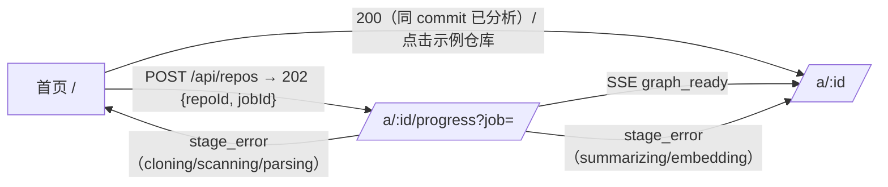

# 可视化代码仓库分析 —— 前端与交互设计文档

> 版本：v1（2026-10-29）。技术栈：Next.js 15 App Router + React 19 + TypeScript + Zustand + Tailwind + React Flow（@xyflow/react）+ elkjs。
> 第 1 周只支持 TypeScript 仓库。接口以总方案 `architecture/ARCHITECTURE.md` §5 为准；本文与总方案不一致的地方见 7.4。

## 1. 设计目标与范围

**目标**：用户输入一个 GitHub 仓库地址后，几十秒内看到可交互的依赖图，并能用自然语言提问。答案中的每条引用都能在图上和代码中定位，「答案可溯源」是核心卖点。

| 范围 | 内容 |
|---|---|
| MVP（W1–W3） | TS 仓库导入（W1 只做 TS，非 TS 仓库在提交时就拦截）；SSE 解析进度；dir/module/file 三层依赖图，支持折叠和展开；文件树与过滤；节点详情与代码预览；流式问答，引用与图高亮联动；暖色纸感浅色主题（默认，深色可选，见第 8 章）；预解析示例仓库：zustand、hono、zod，备选 trpc |
| 加分项（W4 及以后） | 循环依赖检测与标红；两个 commit 的图 diff；路径查询（A 如何依赖 B）；导出 PNG/SVG；多语言（tree-sitter）；分享链接（URL 记录视图状态）；小地图 |
| 不做 | 在线编辑代码、私有仓库 OAuth（W4 之后再考虑）、移动端完整工作台（只提供只读视图） |

**体验指标**：首屏 TTI 小于 2 秒；画布累计 1,500 节点（已开启边抽稀）时交互 FPS 不低于 45；从点击引用到节点聚焦小于 300 ms；第一个 token 在 1.5 秒内出现（不计 LLM 自身延迟）。

## 2. 页面结构与路由

```
app/
├─ (home)/page.tsx               # 首页：输入仓库 URL + 示例仓库卡片
├─ a/[id]/
│  ├─ layout.tsx                 # 工作台三栏布局 + 顶栏（id = repoId，与总方案 §9 一致）
│  ├─ page.tsx                   # 主工作台；URL 参数 ?node=&q= 用于记录视图状态
│  └─ progress/page.tsx          # 分析进度页（?job=<jobId>，订阅 /api/jobs/:jobId/events）
└─ api/ (由后端提供，前端只调用)
```

流程：



主工作台线框：

```
┌──────────────────────────────────────────────────────────────────────┐
│ ◆ RepoLens   honojs/hono @a1b2c3  [搜索节点 ⌘K]   层级: Dir▸Mod▸File  ⚙ │
├──────────────┬──────────────────────────────────────┬────────────────┤
│ 文件树/过滤   │             依赖图 (React Flow)       │ [详情] [对话]   │
│ ▸ src/       │      ○core ───▶ ○utils                │ 节点: src/core  │
│   ▸ core (42)│        ╲         ▲                    │ 类型 module      │
│   ▸ utils    │         ▶ ○hooks ┘                    │ 入度 12 出度 5   │
│ ☑ 隐藏 test  │                                       │ ─ 代码预览 ─     │
│ ☑ 隐藏 node_ │                                       │ 1 export ...     │
│ 搜索: [    ] │   [+][-][⤢适配] [重新布局 ↻]   小地图   │ ─ 对话 ─         │
│ 边类型 ☑imp  │                                       │ Q: 数据怎么缓存? │
│              │                                       │ A: ...[1][2]     │
├──────────────┴──────────────────────────────────────┴────────────────┤
│ 状态栏: 1,284 节点 / 3,902 边 · 已折叠到 module 层 · FPS 60           │
└──────────────────────────────────────────────────────────────────────┘
```

线框说明：页面为米白纸色底（`--bg`），三栏之间只用 1px 细线（`--border`）分隔，不加厚重面板色；中间图区用稍深的暖灰底（`--canvas`）以衬托白色节点卡片；右栏对话为阅读式排版（见第 8 章）。顶栏左侧是 RepoLens 自己的名称和图标。

组件树：

```
<WorkspaceLayout>
├─ <TopBar> (RepoBadge, CommandPalette, LevelSwitcher, Settings)
├─ <ResizablePanels>
│  ├─ <LeftPanel>
│  │  ├─ <FileTree virtualized />        # react-arborist / 自研虚拟列表
│  │  └─ <FilterBar> (Search, ExcludeGlobs, EdgeKindToggle, DepthSlider)
│  ├─ <GraphPanel>
│  │  ├─ <GraphCanvas />                 # dynamic(ssr:false) 包裹 ReactFlow
│  │  ├─ <GraphToolbar /> <MiniMap /> <NodeTooltip /> <ContextMenu />
│  │  ├─ nodeTypes: <ModuleCard /> <FileNode /> <ExternalNode />（均 React.memo）
│  │  ├─ edgeTypes: <WeightedEdge />
│  │  ├─ <CytoscapeFallback />           # 累计节点 >2000 或性能不足时切换
│  │  └─ <LayoutWorkerBridge />
│  └─ <RightPanel tabs>
│     ├─ <NodeDetail> (Meta, Neighbors, CodePreview[Shiki])
│     └─ <ChatPanel> (MessageList, CitationChip, ContextChips, Composer)
└─ <StatusBar />
```

首页由 `<RepoInput>`（URL 校验 + 语言预检提示）和 `<SampleRepoGrid>` 组成。进度页包含 `<StageStepper stages=[queued,cloning,scanning,parsing,graph_ready,summarizing,embedding,done]>`、`<ProgressBar>`、`<LogTail>`（最近 20 条 message），以及 `<StageErrorCard stage message>`。收到 `graph_ready` 后立即跳到工作台；摘要和向量化在后台继续，工作台顶栏用 `<BackgroundProgress>` 小进度条显示 summarizing/embedding 的进度。

## 3. 依赖图渲染选型

| 维度 | **React Flow（@xyflow/react v12）** ✅ 采用 | Cytoscape.js（回退） | Sigma.js v3 + graphology（可选方案） |
|---|---|---|---|
| 渲染 | DOM/SVG（节点是 React 组件，边是 SVG） | Canvas 2D | WebGL |
| 可流畅交互的规模 | 约 1–2k 节点（开启 `onlyRenderVisibleElements` + memo 节点） | 约 2–5k 节点 | 1–10 万节点/边 |
| 节点外观 | 任意 React 组件：可做带标题、摘要、指标的「模块卡片」 | 选择器样式，图形有限 | 需写 WebGL program，定制成本高 |
| 布局 | 不内置，接 elkjs（worker） | 内置 fcose/dagre，也可接 elk | 不内置，可接 elkjs |
| React / Next.js 集成 | 原生 React，hooks + 受控 state，最自然 | react-cytoscapejs（维护一般），命令式 API | @react-sigma/core，命令式 |
| SSR | 需要 `dynamic(..., { ssr: false })` | 同左 | 同左 |
| 定位 | 主渲染器 | 累计节点 >2000 或性能不足时回退 | 只在文件级超大图（>1 万）时考虑，W1–W4 不实现 |

**结论：采用 React Flow + elkjs**（与总方案 §3 一致）。理由：
1. **规模可控，DOM 渲染可行**：后端单次只返回 ≤300 个节点的聚合层，file 层靠 `?parentId=` 懒加载，正常使用时画布在几百到 1,500 节点之间。在这个量级，DOM 渲染配合视口裁剪和 memo 足够流畅，不需要 WebGL。
2. **演示观感**：自定义节点卡片（模块名、摘要首句、文件数、入度/出度）看起来像一张「交互式架构图」，而不是一团点线，演示冲击力更强。
3. **集成最自然**：节点就是 React 组件，可直接复用 Tailwind、Zustand selector、Tooltip、ContextMenu；与 Next.js App Router 的客户端组件模型一致。
4. **布局解耦**：所有层级的坐标都由 elkjs 在 worker 中确定性计算（第 4.5 节），渲染库只负责绘制，因此切到 Cytoscape 回退时可以复用同一份坐标。

**回退**：累计节点超过约 2000，或实测 FPS 持续低于 30 时，提示用户「切换到高性能模式」，用 Cytoscape（Canvas）渲染同一份 nodes/edges/positions。渲染层通过 `GraphRenderer` 接口隔离（`setData / setPositions / highlight / focus`），React Flow 与 Cytoscape 各实现一份。**Sigma.js + graphology** 只作为「文件级超大图」的可选方案记录在本表，不实现。

Next.js 集成要点：

```tsx
// components/graph/GraphCanvas.tsx
import dynamic from "next/dynamic";
export const GraphCanvas = dynamic(() => import("./FlowGraph"), {
  ssr: false,                        // 依赖 window/ResizeObserver，关闭 SSR
  loading: () => <GraphSkeleton />,
});
export const CytoscapeFallback = dynamic(() => import("./CytoscapeGraph"), { ssr: false });

// FlowGraph.tsx（"use client"）
import { ReactFlow, ReactFlowProvider, MiniMap, Background } from "@xyflow/react";
import "@xyflow/react/dist/style.css";
const nodeTypes = { module: ModuleCard, file: FileNode, external: ExternalNode }; // 模块级常量，避免每次渲染重建
const edgeTypes = { weighted: WeightedEdge };
export default function FlowGraph() {
  const nodes = useStore(s => s.flowNodes), edges = useStore(s => s.flowEdges);
  return (
    <ReactFlowProvider>
      <ReactFlow nodes={nodes} edges={edges} nodeTypes={nodeTypes} edgeTypes={edgeTypes}
        onlyRenderVisibleElements nodesDraggable={false} nodesConnectable={false}
        minZoom={0.05} maxZoom={2} fitView proOptions={{ hideAttribution: true }}
        onNodeClick={onNodeClick} onNodeDoubleClick={onNodeDoubleClick} onNodeContextMenu={onContextMenu}>
        <Background gap={24} /> <MiniMap pannable zoomable />
      </ReactFlow>
    </ReactFlowProvider>
  );
}
```

- 自定义节点全部 `React.memo`，props 只传 `id` 和 `data`；高亮等视图状态由节点内部用 Zustand selector 订阅自己的 id（`useStore(s => s.highlight.get(id))`），选中变化时只重渲染受影响的节点。
- 相机控制用 `useReactFlow()` 的 `setCenter / fitBounds / fitView`。

## 4. 大图性能策略

### 4.1 节点规模策略：聚合层 + 懒加载 + 画布累计上限

总方案 §5.2 规定：单次返回的节点数不超过 300。前端不再按仓库总节点数分档，统一采用下面这一套策略：

| 环节 | 规则 |
|---|---|
| 首次加载 | `GET /api/repos/:id/graph`（不传 parentId）返回顶层，节点数不超过 300；超过时后端按聚合层（dir → module）继续上卷。范围外的边聚合为 `kind:"aggregated"`、带 `weight` 的边 |
| 展开 | 双击节点后请求 `?parentId=<nodeId>`，得到该节点的直接子节点（不超过 300 个）和相关边，合并进画布（见 4.3） |
| 画布累计上限 | 以**已展开的累计节点数**计：超过 800 时开启边抽样（4.6）并只显示重点标签；超过 1,500 时弹出提示「画布节点过多，建议收起部分模块」，并提供「一键收起到 module 层」按钮。前端不强制截断 |
| 布局 | 所有层级（dir/module/file）都用 elkjs 计算，在 web worker 中运行（见 4.5）；示例仓库读取预计算的布局文件 |
| 标签 | 累计 ≤300 时全部显示；超过 300 后按缩放比例和度数 top-N 显示 |

> 演示提示：zod、hono 的文件数可能不到数千，「大图折叠」这一镜的效果需要实测。默认让 zod 只展示 module 层，演示前实测节点数，并调整累计提示阈值（见第 9 章检查项）。

### 4.2 目录折叠聚合

```ts
// 把 file 级边聚合到当前可见祖先之间
function aggregateEdges(raw: GraphEdge[], visibleAncestor: (id: string) => string) {
  const map = new Map<string, { source: string; target: string; weight: number }>();
  for (const e of raw) {
    const s = visibleAncestor(e.source), t = visibleAncestor(e.target);
    if (s === t) continue;                       // 内部边折叠后不画
    const k = `${s}->${t}`;
    const cur = map.get(k) ?? { source: s, target: t, weight: 0 };
    cur.weight++; map.set(k, cur);
  }
  return [...map.values()];
}
```

- `visibleAncestor` 沿 `parentId` 向上查找，直到遇到第一个「展开集合」以外的祖先。展开状态 `expanded: Set<string>` 存在 store 中。
- 聚合节点显示 `childCount` 徽标，节点大小按子孙文件数取 sqrt 映射。

### 4.3 按需展开（懒加载）

- 双击聚合节点时，如果子节点还没加载，请求 `GET /api/repos/:id/graph?parentId=<nodeId>`（例如 `?parentId=m:core`）。返回该父节点的直接子节点和相关边，格式同样是 `{nodes, edges, meta}`；指向范围外的边由后端聚合为一条带 `weight` 的边。
- 新子节点的目标坐标由 elkjs 计算（worker 中运行，已有节点作为固定约束，避免整张图跳动；示例仓库直接从布局文件读取）。从父节点位置移动到目标坐标的过程是约 300 ms 的坐标插值动画（rAF 更新 position，ease-out），不跑力导向布局。
- 请求结果用 TanStack Query 缓存，key 为 `["graph", repoId, commitSha, parentId]`。图数据按 commitSha 缓存。

### 4.4 LOD 与渲染裁剪（React Flow）

- **视口裁剪**：开启 `onlyRenderVisibleElements`，视口外的节点和边不进 DOM。
- **memo 自定义节点**：`ModuleCard / FileNode / ExternalNode / WeightedEdge` 全部 `React.memo`，`nodeTypes`、`edgeTypes` 定义在模块顶层；拖拽与连线关闭（`nodesDraggable={false}`）。
- **按缩放分级**（`useStore(s => s.transform[2])` 读 zoom）：zoom < 0.5 时 ModuleCard 只显示标题、隐藏摘要；zoom < 0.3 时隐藏 file 标签，边改为细线并降低透明度；zoom < 0.15 时自动收起到 dir 层，这一项**默认关闭**，只能在设置中手动开启。
- **按累计节点数分级**：累计节点 >800 时开启边抽稀（4.6）和标签精简（只显示度数 top-N 的标签）；>1,500 时提示「画布节点过多，建议收起部分模块」，提供「一键收起到 module 层」；>2,000 或 FPS 持续 <30 时，额外提供「切换到高性能模式（Cytoscape）」。
- 平移或缩放过程中（`onMoveStart`/`onMoveEnd`）临时隐藏边标签和 hover tooltip。

### 4.5 布局算法（统一 elkjs，全部在前端计算，坐标不进服务端数据）

- **所有层级都用 elkjs**：dir、module、file 三层都使用 `elkjs` 的 `layered` 算法（方向 `RIGHT`，`elk.layered.considerModelOrder` 开启，保证确定性），通过 `elkjs/lib/elk-worker` 在 web worker 中运行，不阻塞主线程。同样的输入总是得到同样的坐标，所以可以缓存、预计算和对比。
- 所有坐标都来自 elkjs；展开新节点时只做约 300 ms 的坐标插值过渡（见 4.3），不使用力导向布局。
- 性能兜底：单次 elkjs 布局超过 2 秒时，退回 elk 的 `mrtree` 或简单网格布局并提示（总方案的降级是 dagre，二者择一，W1 实测后定）。
- **示例仓库**（zustand、hono、zod、trpc）：commitSha 在部署脚本中固定。前端脚本 `scripts/gen-layout.ts` 离线用 elkjs 生成布局文件 `apps/web/public/layouts/{owner}-{repo}-{commitSha}.json`（命名以总方案 §5.2 为准），结构为 `{ commitSha, positions: { [nodeId]: [x, y] } }`。布局文件与图数据分开存放，不进服务端，也不依赖任何服务端布局字段。演示时直接读取，同时写入 IndexedDB 预热缓存（key 为 `commitSha + nodeId`）。
- **commitSha 校验**：加载布局文件时比对图数据的 `meta.commitSha`。不一致就丢弃布局文件、退回 elkjs 实时计算，并在控制台告警：`console.warn("[layout] commitSha mismatch", { file, graph })`。
- 非示例仓库一律在现场用 elkjs 计算。

### 4.6 边抽样与隐藏

- 聚合后的边数超过 3×可见节点数时，每个节点只保留权重 top-K 的出边（K=5），其余边设为 `hidden`。状态栏提示「已隐藏 N 条弱边」，可以一键显示全部。
- 接口不下发父子包含边，父子关系由 `parentId`、折叠和颜色表达；`external` 节点的边默认隐藏。
- 选中节点时，强制显示它的全部一跳边（包括被抽样隐藏的边）。

### 4.7 布局缓存

- 统一用 IndexedDB（idb-keyval），以 `commitSha + nodeId` 为 key，存 `[x, y]`。nodeId 由路径确定性生成（`m:src/core`、`f:src/a.ts`），同一 commit 内稳定，所以缓存可以复用，分享链接也可靠。
- 非示例仓库：二次打开时，有缓存的节点直接使用缓存坐标，只对新节点跑 elkjs。
- 示例仓库：首次打开时把布局文件的坐标写入 IndexedDB 做预热，之后与非示例仓库走同一条读取路径。

## 5. 点击节点详情

| 交互 | 行为 |
|---|---|
| hover（悬停 150 ms） | 显示 Tooltip：路径、类型、入度/出度、子文件数。file 节点额外显示前 8 行代码（来自缓存，不发请求） |
| 单击 | 选中节点：节点本身和一跳邻居高亮，其余节点淡出到 15% 透明度；右栏切到「详情」；文件树同步滚动定位；URL 写入 `?node=` |
| 双击 | 聚合节点展开或收起（4.3）；file 节点在右栏打开完整代码预览 |
| 右键 | 上下文菜单：展开/收起、只看此子图（focus mode）、查找依赖路径到…、复制路径、在 GitHub 打开、加入对话上下文 |
| Shift + 单击 | 多选，用于多节点上下文或路径查询 |
| Esc / 点击空白 | 取消选中，恢复全图 |

详情面板内容（`<NodeDetail>`）：
- 头部：图标 + 路径面包屑（可点，用于跳转父节点）+ 类型标签。
- 摘要：LLM 生成的 `summary`。为 `null`（摘要还没生成，后台仍在 summarizing）时显示 3 行骨架屏，收到 `done` 进度事件后重新请求。
- 指标：LOC、导出符号、入度/出度、`topDependents`（被依赖最多的节点，可点击跳转）、是否处于循环依赖中（加分项，来自 `meta.cycles`）。
- 邻居列表：「依赖于」和「被依赖」两个 tab，各自可点击跳转。
- 代码预览：Shiki（浅色用 `github-light` 叠加纸色底，深色用 `vitesse-dark`，见第 8 章），懒加载，`GET /api/repos/:id/files?path=&start=&end=`；支持行区间高亮（与引用共用）；超过 2,000 行时用虚拟滚动。
- 操作：「问问这个模块」，点击后把节点加入对话上下文并切换到对话 tab。

```ts
// GET /api/repos/:id/nodes/:nodeId（总方案 §5.1），用 TanStack Query 按 nodeId 缓存
interface NodeDetail {
  id: string;                         // 例如 "f:src/compose.ts"
  kind: "module" | "file" | "external";
  path: string;
  summary: string | null;             // null 表示摘要还没生成，显示骨架屏
  exports: string[];
  loc: number;
  inDegree: number;
  outDegree: number;
  topDependents: string[];            // nodeId 列表
}
```

## 6. 对话与图高亮联动

### 6.1 SSE 事件处理

```ts
type ChatErrorCode = "LLM_UNAVAILABLE" | "BUDGET_EXCEEDED" | "REPO_NOT_READY" | "RATE_LIMITED";
type ChatEvent =
  | { type: "tool"; name: string; args: Record<string, unknown> }      // 可选：显示「正在读取 xxx.ts」
  | { type: "token"; text: string }
  | { type: "citation"; id: number; path: string; startLine: number; endLine: number; nodeId: string; moduleId?: string } // 只会收到已校验的引用
  | { type: "done"; messageId: number; droppedCitations: number; fallback?: "retrieval"; usage: { in: number; out: number } }
  | { type: "error"; code: ChatErrorCode; message: string; retryable: boolean };  // 替代 done，之后流立即结束

const CLIENT_TIMEOUT_MS = 20_000;   // 前端兜底：20 秒内既没有 token，也没有 done/error

async function chat(repoId: number, sessionId: number, message: string, contextNodeIds: string[], signal: AbortSignal) {
  const s = useStore.getState();
  s.startAnswer();                     // 统一进入 thinking：显示「正在思考…」，第一个 token 到达即切为正文
  let timer = setTimeout(() => s.timeoutAnswer(), CLIENT_TIMEOUT_MS);
  await fetchEventSource(`/api/repos/${repoId}/chat`, {
    method: "POST", body: JSON.stringify({ sessionId, message, contextNodeIds }), signal,
    onmessage(ev) {
      const data = JSON.parse(ev.data);
      if (ev.event === "tool") s.setToolHint(data.name, data.args);
      else if (ev.event === "token") { clearTimeout(timer); s.appendToken(data.text); }
      else if (ev.event === "citation") s.addCitation(data);
      else if (ev.event === "done") { clearTimeout(timer); s.finish(data); }
      else if (ev.event === "error") { clearTimeout(timer); s.failAnswer(data); }   // 不会再收到 done
    },
    onerror(err) { clearTimeout(timer); s.failAnswer({ code: "NETWORK", message: String(err), retryable: true }); throw err; },
  });
}
```

**「正在思考…」状态（所有问题统一）**：发出问题后，前端一律显示「正在思考…」：一块纸面骨架（3 行浅色 shimmer）加一个缓慢呼吸的小圆点动画；收到第一个 `token` 立即切换为正文。前端不判断问题类型，也不新增任何事件。
- 定位类问题（「在哪个文件/哪几行」）由后端缓冲整段答案、校验引用后再一次性下发 `token` 和 `citation`，对前端来说只是「思考」时间更长；非定位类问题照常流式，「思考」状态很短。
- 收到 `tool` 事件时，在骨架下方用小字显示「正在读取 src/compose.ts」。
- 后端缓冲加重试的总耗时上限约 15 秒，超时直接走 `fallback:"retrieval"`。前端另设 20 秒兜底：超过 20 秒还没有任何 token，也没有 `done`/`error`，就主动 abort，并显示「回答超时，请重试」和重试按钮。

**error 事件按 code 区分提示**：

| code | 提示文案 | 重试按钮（看 `retryable`） | 其他 |
|---|---|---|---|
| `LLM_UNAVAILABLE` | 模型服务暂时不可用 | 通常有 | 示例仓库可展示检索片段或缓存答案 |
| `BUDGET_EXCEEDED` | 今日额度已用完，明天再试 | 通常没有 | 禁用输入框，并显示原因 |
| `REPO_NOT_READY` | 仓库还在分析中（摘要/索引未完成） | 有 | 顶栏小进度条高亮，完成后提示可以提问 |
| `RATE_LIMITED` | 提问太频繁，请稍后 | 有，倒计时 10 秒后才可点 | — |

是否显示重试按钮一律以 `retryable` 为准，表里只是常见情况。

### 6.2 流式展示

- token 每 16 ms 合并一次再写入 store（rAF 节流），Markdown 增量渲染（react-markdown + 未闭合代码块容错）。
- citation 到达时，在当前答案末尾追加编号角标 `[n]`。卡片区实时新增 `<CitationChip>`，同时对应节点做一次「脉冲」提示（不移动相机，避免流式过程中画面乱跳）。
- `done` 后启用「聚焦全部引用」按钮，相机 fit 到所有引用节点的包围盒。

### 6.3 点击引用聚焦节点

1. 通过 `nodeId` 查找节点。如果它被折叠，沿 `parentId` 链路逐级展开，必要时触发懒加载。
2. 画布 `setCenter(x, y, { zoom: 1.2, duration: 400 })`（`useReactFlow()`）。
3. 选中该节点，并在右栏代码预览中滚动到 `startLine–endLine` 并高亮。
4. 前端只处理已校验的引用。后端会直接丢弃没通过校验的引用，前端不需要为这类引用做任何特殊展示。

### 6.3.1 done 事件的附加提示
- `droppedCitations > 0`：在该条消息底部用小字（12px，`--text-3`）显示「已过滤 N 条无法校验的引用」。
- `fallback === "retrieval"`：模型给出的引用全部没通过校验，后端改用检索得到的 top-3 片段作为 citation 下发。这些引用的交互与普通引用一样，但要在该回答下方加一个小标签「引用来自检索结果」（灰底胶囊样式，悬浮时解释来源）。
- 回答结束后如果一条引用都没有（没有 citation 事件，也没有 fallback），图上不做任何高亮，也不显示「聚焦全部引用」按钮。

### 6.4 图选中节点作为对话上下文

- 右键「加入对话上下文」、多选，或在详情面板点「问问这个模块」，都会在 Composer 上方显示 `<ContextChip>`（可删除，最多 5 个）。
- 请求体带 `contextNodeIds`，后端优先检索这些节点。Composer 的 placeholder 变为「关于 src/core 提问…」。

### 6.5 高亮视觉规范

| 状态 | 节点 | 边 | 动画 |
|---|---|---|---|
| 选中 | 3px `--accent-strong` 描边 + 放大 1.06 倍 | 一跳边不透明度 100%，颜色 `--text-2` | 150 ms 缩放 |
| 邻居 | 原色，不透明度 100% | 同上 | — |
| 引用命中 | 3px `--accent-strong` 描边 + 8px `--accent` 柔光（30% 不透明度） | — | 到达时柔光淡入淡出 2 次，每次 700 ms |
| 淡出 | 不透明度 25%，标签隐藏 | 不透明度 10% | 200 ms 渐变 |

开启 `prefers-reduced-motion` 时，所有脉冲和相机动画改为瞬时完成。

## 7. 状态管理与前后端接口

### 7.1 Zustand store 切片

```ts
// store/index.ts：使用 slices pattern，一个 store 加多个 slice，subscribeWithSelector
type Stage = "queued" | "cloning" | "scanning" | "parsing" | "graph_ready" | "summarizing" | "embedding" | "done";
interface RepoSlice   { repoId?: number; commitSha?: string; meta?: GraphMeta; setRepo(m: GraphMeta): void }
interface JobSlice    { jobId?: string; stage?: Stage; progress: number; logs: string[];
                        graphReady: boolean;                       // graph_ready 后为 true，可以出图
                        stageError?: { stage: Stage; message: string };
                        onProgress(e: { stage: Stage; progress: number; message?: string }): void;
                        onGraphReady(e: { repoId: number; graphUrl: string }): void;
                        onStageError(e: { stage: Stage; message: string }): void }
interface GraphSlice  { level: "dir" | "module" | "file"; expanded: Set<string>; loadedParents: Set<string>;
                        hiddenEdgeCount: number; renderer: "flow" | "cytoscape";
                        positions: Map<string, [number, number]>; highlight: Map<string, HighlightState>;
                        toggleExpand(id: string): Promise<void>; setLevel(l: Level): void; setRenderer(r: "flow" | "cytoscape"): void }
interface SelectSlice { selected: string[]; hovered?: string; focusMode?: string;
                        select(id: string, additive?: boolean): void; clear(): void }
interface FilterSlice { search: string; excludeGlobs: string[]; edgeKinds: EdgeKind[]; hideTests: boolean }
// ChatMessage: { id; messageId?: number; role; content; citations: Citation[]; status: "thinking" | "streaming" | "done" | "error";
//               toolHint?: string; droppedCitations: number; fallback?: "retrieval"; error?: ChatError }
interface ChatSlice   { sessionId?: number; messages: ChatMessage[]; contextNodeIds: string[];
                        startAnswer(): void; setToolHint(name: string, args: unknown): void;
                        appendToken(t: string): void; addCitation(c: Citation): void;
                        finish(d: { messageId: number; droppedCitations: number; fallback?: "retrieval" }): void;
                        failAnswer(e: ChatError): void; timeoutAnswer(): void; retry(localId: string): void }
interface UiSlice     { rightTab: "detail" | "chat"; panelSizes: [number, number, number]; online: boolean }

type AppState = RepoSlice & JobSlice & GraphSlice & SelectSlice & FilterSlice & ChatSlice & UiSlice;
```

- 图相关状态：`GraphSlice` 保存 `rawNodes / rawEdges`（按 parentId 合并后的服务端数据）、`positions: Map<nodeId,[x,y]>`（elkjs 结果）和 `expanded`；派生出 React Flow 需要的 `flowNodes / flowEdges`（只包含当前可见层，边已按 4.2 聚合、按 4.6 抽稀），用 selector + `shallow` 订阅，只有可见集合变化时才重新计算。
- 高亮状态单独放在 `highlight: Map<nodeId, "selected"|"neighbor"|"cited"|"dimmed">`，由节点组件按自己的 id 订阅，不改写 `flowNodes`，避免整张图重渲染。
- `renderer: "flow" | "cytoscape"` 记录当前渲染器；切换时复用同一份 nodes/edges/positions。
- 持久化：`UiSlice.panelSizes`、`FilterSlice` 存 localStorage；`selected`、`expanded` 同步到 URL，用于分享。
- 服务端数据（图分片、文件内容、节点详情）用 TanStack Query 管理，不进 Zustand。

### 7.2 接口清单（以总方案 §5.1 为准）

| 接口 | 说明 |
|---|---|
| `POST /api/repos` `{repoUrl, ref?}` | `202 {repoId, jobId, status:"queued", repo, commitSha}`；同一 repo 和 commit 已分析过时返回 `200`（直接进入工作台）；非 TS 仓库返回 `422 {error:{code:"UNSUPPORTED_LANGUAGE", message}}` |
| `GET /api/repos/:id` | 仓库和最近一次任务的状态 `{stage, progress, stats, error}`，SSE 降级轮询时使用 |
| `GET /api/repos?repo=owner/name` | 查询已有分析（首页示例卡片命中缓存时使用） |
| `GET /api/jobs/:id/events` (SSE) | `progress {jobId, stage, progress, message}` / `graph_ready {jobId, repoId, graphUrl}` / `stage_error {jobId, stage, message}` / `done {jobId, status, stats}`；支持 `Last-Event-ID` 续传 |
| `GET /api/repos/:id/graph[?parentId=m:src/core]` | 返回 `{nodes, edges, meta}`，单次不超过 300 个节点；带 parentId 时返回直接子节点和相关边，范围外的边聚合为 `aggregated` 边 |
| `GET /api/repos/:id/nodes/:nodeId` | 节点详情（见第 5 章 `NodeDetail`） |
| `GET /api/repos/:id/files?path=&start=&end=` | 读取文件片段，用于代码预览 |
| `POST /api/repos/:id/chat` (SSE) | 请求体 `{sessionId, message, contextNodeIds?: string[]}`；事件 `tool?` / `token` / `citation` / `done`，出错时用 `error` 替代 `done` |

### 7.3 依赖图数据结构（GraphData）

```ts
// 与总方案 §5.2 一致（packages/shared 中的 zod schema 为唯一来源，前端直接 import）
export type GraphData = {
  nodes: Array<{
    id: string;               // 确定性："m:<dir>" | "f:<path>"，同一 commit 内稳定
    type: "module" | "file" | "external";
    label: string;
    parentId?: string;        // 父模块 id；顶层 module 没有这个字段
    path?: string;
    weight?: number;          // 可选：重要度（fanIn 等）
    loc?: number;             // 可选：代码行数
    summary?: string;
  }>;
  edges: Array<{
    id: string; source: string; target: string;
    kind: "import" | "type-import" | "dynamic-import" | "re-export" | "aggregated";
    weight: number;           // 聚合边的值 = 被聚合的 import 次数
  }>;
  meta: { repoId: number; commitSha: string; parentId: string | null; language: "typescript"; cycles?: string[][] };
};
// 不含 x/y 和 meta.layout：布局由前端用 elkjs 计算
```

- 前端说的「dir 层」对应顶层 module 节点（没有 parentId 的 `m:` 节点），「module 层」对应它的子模块，「file 层」对应 `f:` 节点。`external`（npm 包）节点默认隐藏，可在过滤栏开启。
- 子节点数由前端在加载子级后统计，接口不提供 `childCount`。边的样式按 `kind` 区分（见第 8 章）。

前端用 zod 实现相同的 schema，在运行时校验接口返回，校验失败时上报错误并显示错误卡片。

### 7.4 与总方案的对齐点（已对齐 ✅，以 ARCHITECTURE.md 为准）

1. 问答接口：`POST /api/repos/:id/chat`（SSE），请求体为 `{sessionId, message, contextNodeIds?}`。
2. 创建任务：`POST /api/repos {repoUrl}`，返回 `{repoId, jobId, status, repo, commitSha}`；已分析过返回 200；非 TS 仓库返回 422 `UNSUPPORTED_LANGUAGE`。
3. 图接口：`?parentId=` 返回直接子节点和相关边；范围外的边聚合为 `kind:"aggregated"`，`weight` 累加；单次不超过 300 个节点；zod 默认只展示 module 层。
4. 图数据 schema 见 7.3：节点 `type` 为 module/file/external，`weight`、`loc`、`summary` 可选，不含 `x/y` 和 `meta.layout`。
5. nodeId 由路径确定性生成（`m:src/core`、`f:src/a.ts`），同一 commit 内稳定；图数据按 commitSha 缓存；前端布局缓存的 key 为 `commitSha + nodeId`。
6. 布局：前端统一用 elkjs（worker 中运行）；展开时只做坐标插值动画，不用力导向布局。示例仓库固定 commitSha，布局文件为 `apps/web/public/layouts/{owner}-{repo}-{commitSha}.json`；加载时校验 commitSha，不一致就退回 elkjs，并在控制台告警。
7. 引用：只下发校验通过的 citation（`id, path, startLine, endLine, nodeId, moduleId?`）；`done` 带 `messageId`、`droppedCitations`、`fallback?: "retrieval"` 和 `usage {in, out}`。
8. 问答 `error {code, message, retryable}`，code 取 LLM_UNAVAILABLE、BUDGET_EXCEEDED、REPO_NOT_READY、RATE_LIMITED 之一；`error` 后流直接结束，不再发 `done`。另有可选的 `tool` 事件。
9. 进度：阶段固定为 queued → cloning → scanning → parsing → graph_ready → summarizing → embedding → done；事件为 `progress`、`graph_ready`（收到即可出图）、`stage_error {stage, message}`、`done`。节点详情接口为 `GET /api/repos/:id/nodes/:nodeId`。
10. 定位类问题不流式：后端缓冲并校验后一次性下发，前端没有撤回或替换逻辑；后端总耗时上限 15 秒，超时走 fallback；前端统一显示「正在思考…」，并设 20 秒兜底超时。

11. 渲染库：React Flow（@xyflow/react）+ elkjs，Cytoscape 为累计节点 >2000 或性能不足时的回退；Sigma.js + graphology 只作为文件级超大图的可选方案出现在第 3 章对比表中。
12. 演示：总长约 3 分钟，hono 主线，结尾 20 秒演示 MCP `ask_repo`。

前端新增、总方案未提及但不影响接口的行为：只有前端 20 秒兜底超时一项。

## 8. 视觉规范

### 8.1 风格定位

整体气质参考 Claude 公开网页和产品的观感：温暖的米白纸感、深炭灰文字、陶土色强调、衬线标题、大留白、克制的动效，读起来像一份排版良好的文档，而不是一块霓虹仪表盘。**只借鉴气质：不使用 Claude/Anthropic 的名称、logo、星芒图形或其任何商标素材，产品使用自己的名称（RepoLens）和自己的图标。**

- **字体**：标题用衬线 `"Source Serif 4", Georgia, "Times New Roman", serif`（中文回退 `"Noto Serif SC"`）；正文与 UI 用 `Inter, system-ui, -apple-system, "PingFang SC", "Microsoft YaHei", sans-serif`；代码用 `"JetBrains Mono", ui-monospace, SFMono-Regular, Menlo, monospace`。字号：正文 15px/1.65，UI 13–14px，标题 20/24/30px。
- **留白与形状**：基础间距 4px 网格，面板内边距 24px；卡片圆角 12px，小元素（胶囊、按钮）圆角 8px 或全圆；边框 1px `--border`；阴影极轻 `0 1px 2px rgba(31,30,29,.06)`，hover 时 `0 2px 8px rgba(31,30,29,.08)`。
- **动效**：只用淡入（150–200 ms）和 4px 以内的轻微位移；展开子节点 300 ms ease-out；没有持续性动画（「正在思考…」的呼吸圆点除外，开启 `prefers-reduced-motion` 时也改为静态）。

### 8.2 颜色 token（CSS 变量 / Tailwind）

对比度均按 WCAG 2.x 公式计算：正文 ≥4.5:1，大字和图形 ≥3:1。

| token | 浅色（默认） | 深色（可选，暗暖灰） | 用途 / 对比度（浅色） |
|---|---|---|---|
| `--bg` | `#F5F4EE` | `#1F1E1C` | 页面纸色底 |
| `--surface` | `#FFFFFF` | `#2A2926` | 卡片、节点、输入框 |
| `--surface-2` | `#EEECE2` | `#33312D` | 用户消息块、悬浮态 |
| `--canvas` | `#EAE7DD` | `#262522` | 依赖图区底色（比页面稍深，衬托白色节点） |
| `--border` | `#E3E0D5` | `#3A3834` | 细分割线 |
| `--border-strong` | `#3D3A35` | `#B5B2A8` | 节点 1.5px 描边（对 `--canvas` 9.15:1） |
| `--text` | `#1F1E1D` | `#ECEAE3` | 正文（对 bg 15.1:1，对 canvas 13.45:1） |
| `--text-2` | `#5E5D59` | `#B5B2A8` | 次要文字（对 bg 5.98:1，对 canvas 5.33:1） |
| `--text-3` | `#6B6963` | `#9C998F` | 说明小字（对 bg 4.98:1，对 canvas 4.44:1，图区内只用于 ≥14px 粗体或改用 `--text-2`） |
| `--accent` | `#C15F3C` | `#D97757` | 陶土色：按钮底、图形、柔光（对 bg 3.83:1，对白 4.23:1，只用于图形或白字按钮的大字） |
| `--accent-strong` | `#A8502F` | `#E08A6A` | 强调文字、链接、高亮描边（对 bg 4.95:1，对 canvas 4.4:1，对白节点 5.45:1） |
| `--danger` | `#B23B2E` | `#E5806F` | 错误、循环依赖边（对 bg 5.36:1） |

Tailwind 中在 `theme.extend.colors` 里映射为 `bg`、`surface`、`canvas`、`line`、`ink`、`ink-2`、`ink-3`、`clay`、`clay-strong`、`danger`，值为 `rgb(var(--x) / <alpha-value>)`；深色通过 `[data-theme="dark"]` 覆盖变量，默认浅色，跟随系统时读 `prefers-color-scheme`。

**目录配色（柔和色板，与米白底协调）**：按顶层目录名哈希取色，同一目录在不同会话中颜色稳定。以下 8 色对 `--bg` 都 ≥3:1（图形对比度达标），用作色条和圆点，文字一律用 `--text`，不用这些颜色写字。

| sage `#5F7A5B` (4.31) | slate `#4F6D8A` (4.90) | ochre `#9A7B2F` (3.63) | plum `#8A5A7A` (4.98) | teal `#3F7C77` (4.37) | clay-brown `#8C6A52` (4.43) | olive `#6E7340` (4.55) | rose `#A15C63` (4.51) |
|---|---|---|---|---|---|---|---|

陶土色 `--accent` 留给交互强调和高亮，不进目录色板，避免与引用高亮混淆。多语言阶段改为按语言取色，目录色作为色条。

### 8.3 依赖图（React Flow 节点、边、高亮）

图区使用 `--canvas`（`#EAE7DD`）底加极淡点阵（`#D9D5C8`，24px 间距）。白色节点（`--surface`）对 canvas 只有 1.24:1，因此**所有节点都加 1.5px `--border-strong` 描边**（9.15:1），不靠底色区分。

三层靠**形状 + 尺寸 + 填充深浅**区分，颜色只是辅助：

| 层 | 组件 | 形状 | 尺寸 | 填充 / 描边 |
|---|---|---|---|---|
| dir（顶层 module） | `<ModuleCard variant="dir">` | 圆角 12px 大卡片，标题用衬线字体 | 宽 240–300px，高 ≥96px | 填充 `--surface-2`（较深），1.5px 实线描边，左侧 6px 目录色条，右上角文件夹图标 |
| module | `<ModuleCard>` | 圆角 12px 卡片 | 宽 200–260px（按 sqrt(文件数)），高 72–88px | 填充 `--surface`（白），1.5px 实线描边，左侧 4px 目录色条；内容为模块名（14px 半粗）、摘要首句（12px `--text-2`，`summary` 为空时显示骨架条）、指标行「N 文件 · 入 12 / 出 5」；可展开时显示 ▸ |
| file | `<FileNode>` | 全圆角胶囊 | 高 24px，宽随文件名、上限 160px | 填充 `--surface`，1.5px 描边，左侧圆点（目录色，直径 `6 + 2·sqrt(inDegree)`，上限 14px），文件名 12px 等宽字体；`.d.ts` 用虚线描边 |
| external | `<ExternalNode>` | 小胶囊 | 高 20px | 填充 `--canvas`，1px 虚线 `--text-3` 描边（对 canvas 4.44:1），文字 `--text-2`，默认隐藏 |

边：
- `import`：1.25px 实线，颜色 `--text-2` 不透明度 55%，smoothstep 路径，小箭头。`type-import` 点线，`dynamic-import` 短虚线，`re-export` 空心箭头。
- `aggregated`（`<WeightedEdge>`）：线宽 `1 + 1.5·log2(weight)`，上限 8px，颜色 `--text-2` 不透明度 40%；hover 时中点显示 weight 小胶囊（白底细边框）。
- 循环依赖（加分项）：`--danger` 虚线。

高亮（陶土色描边 + 柔光，而不是霓虹；详见 6.5）：
- 选中：3px `--accent-strong` 描边（对 canvas 4.4:1、对白节点 5.45:1）+ 轻微放大；邻居保持原样，其余淡出到 25%。
- 引用命中（citation 脉冲）：**3px** `--accent-strong` 描边 + 8px `--accent` 柔光（`box-shadow: 0 0 0 3px var(--accent-strong), 0 0 12px 4px rgb(193 95 60 / .30)`），柔光淡入淡出 2 次；脉冲结束后保留 3px 描边直到下一次提问。投屏模式（设置项，或 `?present=1`）把描边加到 **4px**、柔光不透明度提到 45%。
- 深色模式：描边改为 `#E08A6A`（对 `#262522` 约 5.5:1），柔光用 `#D97757`（对深色 canvas 4.91:1）。

### 8.4 对话面板：阅读式排版

- 不用左右气泡堆叠。助手回答直接排在纸面上：最大宽度 68ch，正文 15px/1.7，段落间距 12px，标题用衬线字体，代码块用 `--surface-2` 底、12px 圆角、等宽字体。
- 用户消息是一块浅色圆角块（`--surface-2`，圆角 12px，内边距 12px 16px），右对齐、宽度随内容（最大 80%）。
- 引用角标 `[n]` 用 `--accent-strong` 小号上标；引用卡片 `<CitationChip>` 是白底细边框胶囊，显示 `path:startLine–endLine`。「已过滤 N 条无法校验的引用」用 12px `--text-3`；「引用来自检索结果」用 `--surface-2` 底胶囊加文字标签。
- 「正在思考…」：与正文同宽的 3 行骨架条（`--surface-2` → `--border` 的 shimmer，1.6 s 一轮）加一个 6px 陶土色呼吸圆点，旁边是 13px `--text-2` 文字「正在思考…」。

### 8.5 响应式与无障碍

- **响应式**：≥1280px 三栏布局；1024–1279px 右栏变成抽屉；<1024px 只显示图加底部抽屉（详情/对话），隐藏文件树，改为 ⌘K 搜索。
- **无障碍**：所有交互可用键盘完成（Tab 在三栏间切换，方向键在邻居间移动选中，Enter 展开，`/` 聚焦搜索）。图提供等价的「列表视图」供屏幕阅读器使用，通过 aria-live 播报选中变化。文字对比度 ≥4.5:1，图形 ≥3:1（见 8.2）。层级和状态靠形状、尺寸、描边样式和文字标签区分，不只靠颜色。焦点环为 2px `--accent-strong` 外加 2px 偏移。

### 8.6 投屏验收

- 在投影仪和低亮度显示器（亮度调到 30%）上各实测一遍：hono 模块图、下钻后的文件层、一次带引用的问答。
- 检查项：三层节点在不看颜色时能分辨；节点描边在 canvas 上清晰可见；引用高亮的 3px 描边（投屏模式 4px）和柔光在 3 米外可辨认；正文和次要文字可读；深色模式下同样过一遍。
- 不达标时依次调整：开启投屏模式 → 加深 `--canvas` 到 `#E2DED2` → 把边的不透明度提到 70%。

## 9. 演示视觉效果与演示脚本

**演示视觉**：默认浅色纸感主题；图区暖灰底衬托白色模块卡片，引用高亮为陶土色描边加柔光；对话为阅读式排版。演示时开启投屏模式（描边 4px）。

**演示仓库**（架构师已定，全部是开源 TS 仓库，全部预解析，并配有前端预计算布局 fixture 和缓存答案）：
1. 主演示：`honojs/hono`。问答联动全部在这里演示，兜底录屏也用它录。
2. 小规模：`pmndrs/zustand`。展示「秒出图」。
3. 较大规模：`colinhacks/zod`。展示默认只显示 module 层的折叠视图和懒加载展开。
4. 备选：`trpc/trpc`。上面任一仓库出问题时替换。

**分镜（约 3 分钟，与总方案 §1.3 一致）**：

| 时间 | 操作 | 讲解要点 |
|---|---|---|
| 0:00–0:20 | 首页粘贴 `https://github.com/honojs/hono`，点击分析（命中预解析缓存） | 输入简单；接手陌生仓库的痛点 |
| 0:20–0:50 | 进度条走完各阶段（SSE 实时，回放模式），graph_ready 后立即出图，摘要在后台继续 | 异步队列、流式进度；解析分工：Tree-sitter 负责切分代码块和提取符号，ts-morph 负责解析 TS 的 import 路径（含 tsconfig paths），解析失败时降级为纯 Tree-sitter |
| 0:50–1:40 | 模块图自动布局（elkjs，预计算坐标）；点击模块卡片看 LLM 摘要和邻居高亮；双击下钻到文件依赖（`?parentId=` 懒加载，展开动画） | 可视化 + 聚类；模块卡片即「交互式架构图」 |
| 1:40–2:40 | 提问「中间件是怎么串联执行的？」，流式回答，引用依次脉冲；点击 [2]，画布飞到对应文件节点，代码高亮到行；底部小字「已过滤 N 条无法校验的引用」。时间允许时追问定位类问题「路由匹配在哪个文件？」，展示「正在思考…」后答案一次性出现 | RAG + Agent + 引用联动；只展示经后端校验的引用 |
| 2:40–3:00 | 切到 Cursor，通过 MCP 调用 `ask_repo`（同一 repoId、同一问题），展示返回的带引用答案 | 同一能力以 MCP tools 暴露给 Cursor/Claude（总方案 §5.5：analyze_repo、get_architecture、get_dependencies、search_code、ask_repo） |

zustand（秒出图）和 zod（默认 module 层、按需下钻）不在 3 分钟主线中，作为问答环节的备用镜头或答疑时展示。

**演示前检查项**：
- [ ] 实测 hono、zustand、zod、trpc 的聚合层节点数和完全展开后的累计节点数，据此调整累计提示阈值（默认 800/1,500），确保 zod 这一镜确实能体现「折叠」。
- [ ] 确认部署脚本里固定的 zustand、hono、zod（以及 trpc）commitSha 与 `apps/web/public/layouts/{owner}-{repo}-{commitSha}.json` 一致；打开控制台，确认没有 `[layout] commitSha mismatch` 告警。
- [ ] 跑一遍 hono 的固定问题，确认 citation 能高亮、droppedCitations 提示正常显示。
- [ ] 设置中的「缩放自动收起」保持关闭；确认渲染器为 React Flow（没有误切到 Cytoscape）。
- [ ] Cursor 中已配置 MCP server（stdio），`ask_repo` 用 hono 的 repoId 跑通一次。
- [ ] 演示前一天在演示机上完整实跑一遍（含 Cursor 的 MCP 调用），并确认主流程录屏和 MCP 录屏都在本地可播放。
- [ ] 投屏验收：在投影仪/低亮度显示器上实测一遍，按第 8 章「投屏验收」逐项检查。

**兜底方案**：演示只使用预解析仓库（进度页可用回放模式，重放录制好的 SSE 事件）；问答准备缓存答案；兜底录屏用 hono 录制完整主流程（示例仓库全部用预计算布局），本地和网盘各放一份；任何一个仓库出问题时换成 trpc；演示前清空浏览器扩展、预热 IndexedDB 布局缓存（key 为 commitSha + nodeId）。详见下文「风险与降级方案」R.2。

## 10. 4 周前端任务拆分

| 周 | 任务 | 交付物与验收标准 |
|---|---|---|
| W1 | Next.js 脚手架、主题 tokens（8.2 的 CSS 变量 + Tailwind 映射，浅色默认、深色可选，字体加载）、路由 `/`、`/a/[id]`、`/a/[id]/progress`；RepoInput（TS 预检，处理 422）；进度页接入 SSE（8 个阶段、graph_ready 即出图、stage_error）；elkjs worker 布局；React Flow 渲染 `{nodes, edges, meta}`（dynamic ssr:false，ModuleCard/FileNode/ExternalNode 初版）；三层折叠与边聚合；文件树基础版；zod schema；mock server（MSW） | 能导入 TS 仓库并看到 module 层的图；示例仓库 1 个 |
| W2 | 节点交互（hover、选中、双击、右键）；NodeDetail（`/nodes/:nodeId`，summary 骨架屏）+ Shiki 代码预览（`/files`）；`?parentId=` 懒加载 + elkjs 增量布局（已有节点固定）+ 展开插值动画；布局文件生成脚本 `scripts/gen-layout.ts`，commitSha 校验；IndexedDB 布局缓存；过滤栏；Zustand 切片完成 | 画布累计 1,500 节点（开启抽稀）时 FPS ≥ 45；交互项全部可用 |
| W3 | ChatPanel 流式问答（`/chat`，tool 提示，按 code 处理 error，「正在思考…」状态和 20 秒兜底超时）；citation 联动（展开链路、相机聚焦、行高亮）；上下文 chip；droppedCitations 小字提示与「引用来自检索结果」标签；LOD（onlyRenderVisibleElements、memo 节点、按缩放分级）、>800 边抽稀与标签精简、>1,500 收起提示；`GraphRenderer` 接口 + Cytoscape 回退（>2,000）；错误和离线降级 | 引用点击到聚焦 <300 ms；断网、LLM 失败时 UI 符合 R.4 |
| W4 | 视觉打磨（阅读式对话排版、节点三层形态、投屏模式）、深色模式检查、响应式、无障碍（键盘、列表视图）；zustand、hono、zod、trpc 固定 commitSha 预解析，生成布局文件并预热缓存，准备缓存答案；SSE 回放模式；MCP 演示联调（Cursor 调 `ask_repo`）；3 分钟演示录屏；Playwright E2E 冒烟测试 + Lighthouse；README 与 GIF。加分项按剩余时间取：循环依赖、导出 PNG、分享链接 | 演示脚本彩排 3 次无故障；8.2 所有 token 对比度达标（axe 检查通过）；8.6 投屏验收通过；演示前一天完成整机实跑（含 MCP） |

## 附录 A：接口约定

接口原文以 `architecture/ARCHITECTURE.md` §5.1–5.2 为准，本文 7.2 和 7.3 是它的前端摘录。旧版附录已作废，不再保留。

## 附录 B：第 1 周范围
- 仅 TypeScript：Tree-sitter 负责切分代码块和提取符号，ts-morph 负责解析 TS 的 import 路径（含 tsconfig paths），解析失败时降级为纯 Tree-sitter。非 TS 仓库返回 422 `UNSUPPORTED_LANGUAGE`。
- 前端完成「创建任务 → 进度 SSE → 出图（elkjs）」的端到端链路 + 预解析示例仓库（hono、zustand、zod，备选 trpc）。

## 风险与降级方案

### R.1 大图性能降级
- 总方案规定单次最多返回 300 个节点，超过时上卷到聚合层（dir → module），file 层只能通过 `GET /api/repos/:id/graph?parentId=` 懒加载。前端不按仓库总节点数分档。
- 画布按已展开的累计节点数控制：超过 800 时开启边抽样和标签精简；超过 1,500 时提示收起，并提供「一键收起到 module 层」。
- 折叠后的边由后端聚合为 `aggregated` 边（带 `weight`），前端在本地展开时也做同样的聚合，避免边爆炸；React Flow 开启 `onlyRenderVisibleElements`，自定义节点全部 memo；累计节点 >800 抽稀边与标签，>1,500 提示收起，>2,000 或 FPS 持续 <30 时提示切换到 Cytoscape（Canvas）回退，复用同一份坐标。
- 布局慢：elkjs 在 worker 中运行，不阻塞界面；单次超过 2 秒退回简单布局；示例仓库使用预计算布局文件。
- 引用命中被折叠的 file 节点时，只展开它的祖先链路，不展开整张图。

### R.2 演示稳定性
- 预解析示例仓库（架构师已定）：小规模 `pmndrs/zustand`（快速出图）、中等规模 `honojs/hono`（主演示）、较大规模 `colinhacks/zod`（演示大图默认折叠），备选 `trpc/trpc`；commitSha 在部署脚本中固定，图数据和索引提前落库，布局文件按 commitSha 命名并离线生成，首页一键打开，不依赖现场 clone 和解析。降级顺序：线上实时 → 打开预解析缓存 → 播放 hono 兜底视频。
- 为示例仓库准备若干固定问题及缓存答案（含已校验的 citation），LLM 不可用时可回放。
- 兜底录屏：完整演示流程（导入 → 进度 → 图谱折叠/展开 → 问答流式输出 → 引用高亮）用 hono 录一份 2–3 分钟视频，现场任一环节失败直接切录屏。
- MCP 兜底录屏：结尾约 20 秒的「Cursor 通过 MCP 调用 `ask_repo`」单独提前录好（同一 hono repoId、同一问题），MCP 连接或 Cursor 出问题时直接播放这段。

### R.3 引用校验失败时的前端展示
- 校验在后端完成，没通过的引用不会下发，前端不需要做任何特殊展示。
- `done.droppedCitations > 0`：在消息底部用小字提示「已过滤 N 条无法校验的引用」。
- `done.fallback === "retrieval"`：引用来自检索 top-3 兜底，在回答下标注「引用来自检索结果」，引用照常可点击并高亮。
- 校验后一条引用都没有：不做任何图高亮，答案以纯文本展示。

### R.4 LLM / 网络故障时的 UI 降级
- 问答 SSE 中断（网络）：保留已输出的 token，显示「回答中断」和「重试」按钮；已下发的 citation 保持可点。
- 问答 `error` 事件：按 code 显示不同提示（见 6.1 的表），`retryable` 为 true 时显示重试按钮；`error` 之后不会再收到 `done`，消息状态直接置为 error。`LLM_UNAVAILABLE` 时，示例仓库回退到缓存答案并标注「缓存结果」。
- 回答等待：统一显示「正在思考…」；定位类问题后端 15 秒内会走 `fallback:"retrieval"`；前端 20 秒仍无结果则 abort，显示「回答超时，请重试」。
- 进度 `stage_error`：summarizing 或 embedding 失败时图照常可用，顶栏提示「摘要已降级为规则摘要」之类的后端 message；cloning、scanning 或 parsing 失败时，在进度页显示错误卡片并引导回首页。
- 解析进度 SSE 断开：自动重连并拉取最新快照；多次失败后改为轮询 `GET /api/repos/:id`（读取 stage 和 progress）。
- 图谱接口失败：展示纯文件树（目录列表）作为降级视图，问答仍可用。
- 整体离线：前端检测 `navigator.onLine`，禁用提交按钮并提示，已加载的图和答案仍可浏览。
